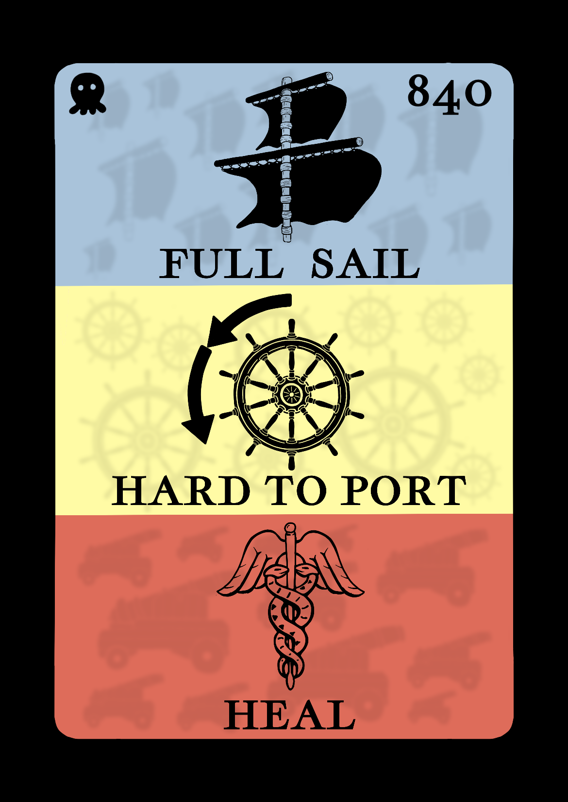
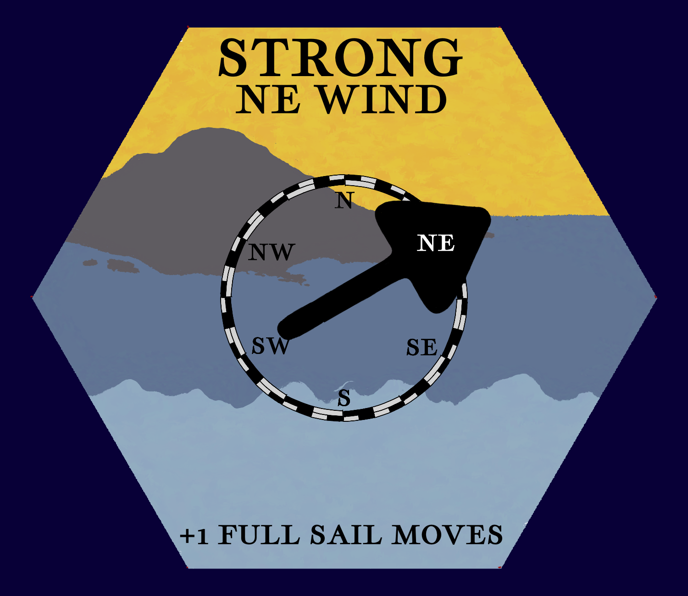
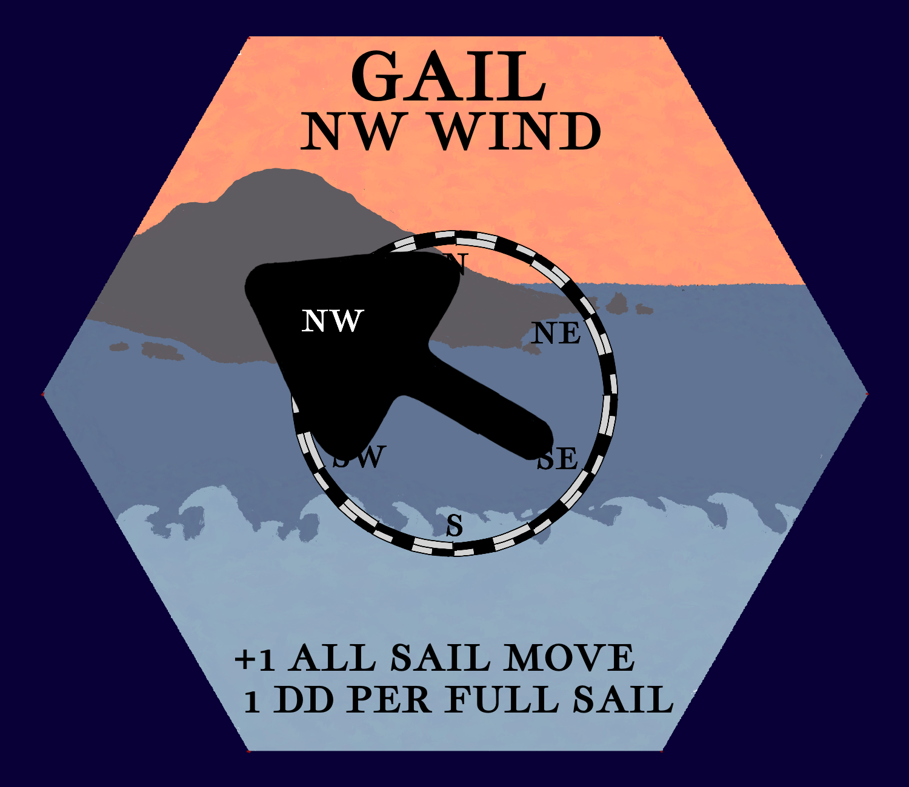
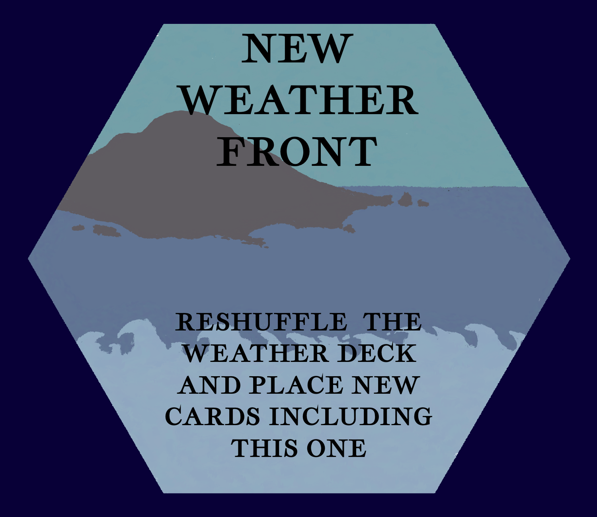
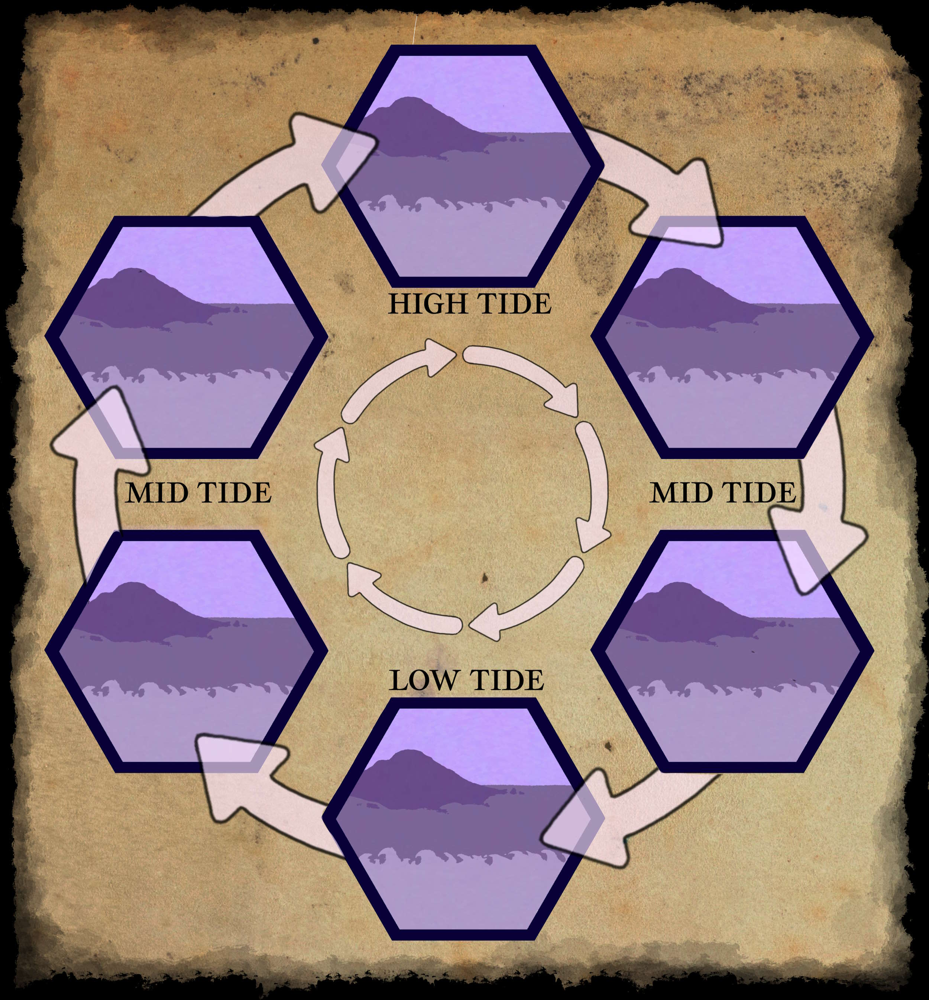
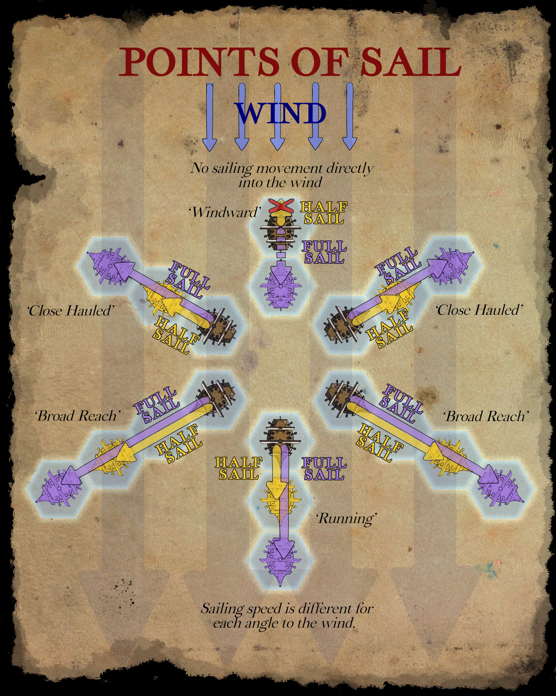
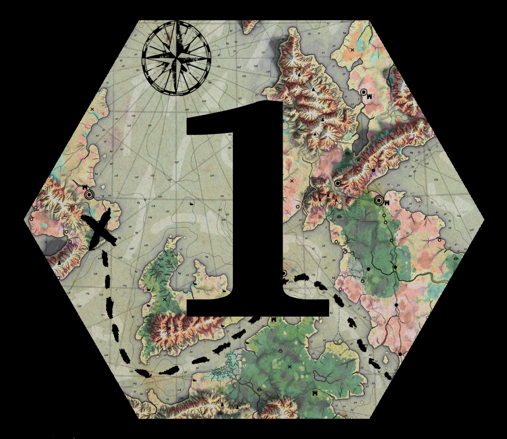
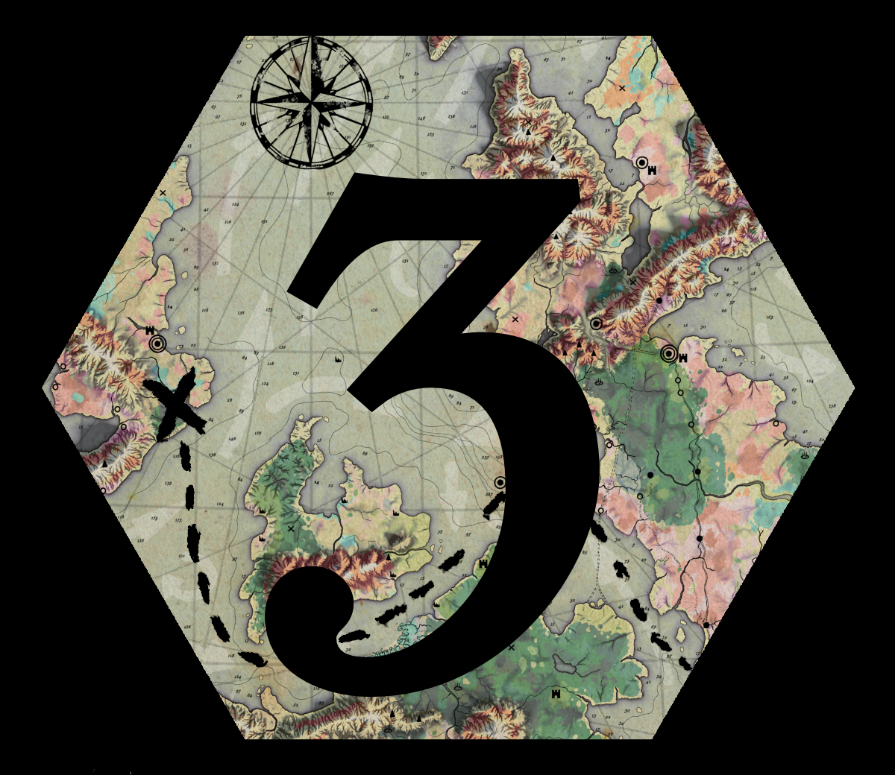

# Mammoth Sea Battles — Rules Specification

> Working spec, built up incrementally. This is the precise source of truth for
> the online version; player-facing instructions will be written from it later.
>
> Status: **Draft v0.30**

## 1. Overview
A pirate sea battle and race game between crews of **anthropomorphic mammoth and
dinosaur pirates**. Players fight each other, race to grab treasure, or both.

**Core mechanic: programmed movement**, in the RoboRally family (see
[`research/roborally.md`](research/roborally.md)). Players draw movement cards and
program their ship's orders face down. Then the orders are carried out and the ships
interact with each other and with the sea.

### 1.1 Kept from RoboRally
- Draw movement cards and program them face down, then reveal and resolve them.
- Ships **push** each other and **shoot** at each other.
- **The board moves ships**: sea currents work like RoboRally's conveyor belts.
- **Damage affects movement**.

### 1.2 Key differences from RoboRally
| # | Mammoth Sea Battles | RoboRally |
|---|---|---|
| D1 | **Hex** map | Square grid |
| D2 | **3 steps** per turn | 5 registers |
| D3 | Each step programs **sailing, steering and cannon separately** | One card per register |
| D4 | **Tides** change the board during play | Fixed board |
| D5 | **Wind** affects movement | None |
| D6 | Cannons mostly mounted **broadside** | Laser fires forward |
| D7 | Different damage model | Hand-size loss (classic) / damage cards in deck (2016) |
| D8 | **Crew** works a bit like upgrade/option cards | Option or upgrade cards |
| D9 | Two factions: mammoths vs dinosaurs | Generic robots |

## 1.3 Design pillars
- **P1. Simultaneous everything.** Everyone programs at the same time, and then **everyone executes
  each step at the same time**: all players move their own ships together. There is no going round the
  table, ship by ship. This is why the game scales to 8 players: adding players adds almost no waiting time.
- **P2. Trust at the table.** Physical play relies on players moving their own ships honestly and
  sorting out minor collisions in good faith. Rules should stay simple enough to make that easy.
- **P3. Embrace chaos.** Collisions, currents and plans going wrong are the fun. Don't over-engineer
  the rules to remove chaos; a relaxed, slightly anarchic vibe is the goal.
- **P4. The online version enforces what the table trusts.** The digital version needs a deterministic
  conflict rule for when ships interfere (see Q8) that gives the same result simultaneous play would at the table.

## 2. Players & duration
- Players: **2–4 for the first version; the target is up to 8**. Rules, components and the
  online engine should be designed so 8 is possible, even though playtesting starts at 4.
- Play time: _TBD_
- Age: _TBD_

## 3. Components

### 3.1 The board

- **Modular**: you build the sea by putting several hex **board tiles** together, so scenarios and
  board size can vary (this also helps it scale to 8 players, see Q3c).
- The play area is a **hex grid**. In the example the hexes are pointy-topped, with flat sides on the left and right *(to confirm, Q18)*.
- **Sea currents** are printed as arrows. A current acts on a ship sitting on it, **moving her and/or turning her** (like RoboRally conveyors and gears).

### 3.2 Board features seen in the example board
Interpretations marked ❓ are guesses, to be confirmed by the designer.

| Feature | What it looks like | Interpretation |
|---|---|---|
| Straight current | Single arrow along the hexes | Moves the ship 1 hex in the arrow's direction ❓ |
| Fast current | Double (and triple?) parallel arrows | Moves the ship 2 (3?) hexes, like RoboRally's express belts ❓ |
| Turning current | Curved arrow | Moves the ship and turns her ❓ |
| Eddy | Circular arrows inside one hex, clockwise or anticlockwise | Turns the ship in place (60° per activation?) ❓ |
| Dashed eddy | Same, with a dashed outline | Weaker, or only active at certain tides? ❓ |
| Gyre / loop current | Ring of arrows circling an island, or an oval loop over 2 hexes | Carries ships round the loop ❓ |
| Maelstrom | Large multi-ring spiral (lower right) | Pulls ships inward and turns them; damage or loss at the centre? ❓ |
| **Whirlpool portal** (numbered, e.g. "1") | Two matching whirlpools | **Core feature.** Paired portals; see §3.6. |
| Sea caves A / B | Cave mouths on islands marked A and B, with exit arrows | Tunnels: enter A, exit at the other A, facing the arrow ❓ |
| Island | Land | Impassable; ships hitting it take collision damage? ❓ |
| Reef / rocks | Pink spiky edges round islands; wreck-strewn rocky hexes with a skull | Hazard: damage, grounding, or sinking? ❓ |
| Sandbanks | Yellow patterned areas | Shallows: impassable or slowing, **tide-dependent**? ❓ |
| Striped shallows | Pale green diagonal stripes | Shallow water or kelp, maybe exposed at low tide? ❓ |
| Rough water | Purple churning hex | Hazard, maybe damage or random drift? ❓ |
| Fog bank | White cloud (centre) | Blocks line of sight for cannon? ❓ |
| Storm | Dark cloud with lightning (left edge) | Damage or random wind; does it move? ❓ |
| Port town | Harbour town (bottom) | Repair, recruit crew, deliver treasure, start point? ❓ |
| Small wreck on sandbar | Upper left | Treasure location? ❓ |

### 3.2.1 Whirlpool portals *(core rule)*
Portals are a **core** feature, not optional; they're a big part of the fun (as in RoboRally).
- Whirlpools come in **pairs, matched by number**.
- **Entering** a whirlpool hex teleports the ship **immediately** to the partner whirlpool.
- She **keeps her heading** and **carries on with any remaining movement** from the partner hex.
- **Any movement triggers it**: sailing, being pushed, currents, wind drift.
- **Blocked**: if the partner whirlpool is occupied, the ship **does not travel** through the portal *(what happens instead: Q45)*.
- Assumed ❓: **arriving** at a whirlpool through the portal doesn't trigger it again (no infinite loop), and a ship that starts on a
  whirlpool and moves off it doesn't trigger it.

### 3.3 Command cards
   

Each command card is split into **three coloured bands**, one for each kind of order:

| Band | Colour | Order type | Values seen so far |
|---|---|---|---|
| Top | Blue | **Sail** | No Sail, Half Sail, Full Sail |
| Middle | Yellow | **Steer** | Ease Port (small turn), Hard to Port (large turn) |
| Bottom | Red | **Action** (cannon background) | Fire Cannons, Heal, Repair |

Each card also has an **initiative number** in the top-right corner (e.g. 400, 420, 840, 860), used like
RoboRally's priority numbers (see §5.3). The hundreds digit seems to follow the sail band (4xx = Half Sail,
8xx = Full Sail), so faster cards win initiative. Some cards also have an **octopus icon 🐙** in the top-left corner. It is used to **move the sea monster**, an
**optional role/module** to be specified later (see §10).

Example cards seen:

| No. | Sail | Steer | Action | Icon |
|---|---|---|---|---|
| 400 | Half Sail | Ease Port | Fire Cannons | 🐙 |
| 420 | Half Sail | Ease Port | Heal | |
| 840 | Full Sail | Hard to Port | Heal | 🐙 |
| 860 | Full Sail | Hard to Port | Repair | |

### 3.4 Ship board

Each player has a **ship board** with **3 Parts (I, II, III)**, one per step of the turn. Each Part has three card slots, in this order:
**Move (Sail) → Steer → Action**. The slot art highlights the band that counts (blue top / yellow middle / red bottom), so
**a card placed in a slot uses only that slot's band**. The same card can be a Sail, Steer or Action order depending on where you put it.

The board also works as the turn-sequence reminder, printing Currents and Wind drift between the slots (see §5.2).

- **Up to 9 cards** per turn (3 Parts × 3 slots).
- **Empty slots**:
  - Empty **Move** slot → the **sail stays at its current level**. Sail level is a **persistent setting** carried from Part to Part and turn to turn.
  - Empty **Steer** slot → no turn.
  - Empty **Action** slot → no action.

### 3.5 Weather cards and weather circuit
      

- Weather cards are **hex-shaped**. Each shows a **wind strength** and a **wind direction** on a 6-point compass
  (**N, NE, SE, S, SW, NW**). These are the 6 directions of flat-topped hex sides, so the wind always runs along a hex direction.
- **Weather is predictable**: cards are drawn and placed on a **weather circuit** that shows the current weather and the **next two
  cards face up**. The circuit also **marks the tides** (§6.4).

**Weather board**

- A ring of **6 hex spaces** for weather cards, advancing **clockwise**.
- Each space is also a **tide state**: High → Mid → Mid → Low → Mid → Mid → (back to High).
  That is a **6-step tide cycle** with 3 levels (High / Mid / Low), so the sea is at Mid tide half the time.
  - Top space = **High**.
  - Two right-hand spaces = **Mid** (ebbing).
  - Bottom space = **Low**.
  - Two left-hand spaces = **Mid** (flooding).
- *How the current space is marked and how cards are refilled: Q37.*

| Card | Strength | Sail modifier (printed) | Wind drift per turn (§5.2) |
|---|---|---|---|
| Dead Calm | — | **No sail move** | 0 |
| Light (e.g. North) | Light | **−1 all sail moves** | 0 ❓ |
| Firm (e.g. North, SE) | Firm | none | 1 (Part III) |
| Strong (e.g. NE) | Strong | **+1 Full Sail moves** | 2 (Parts II, III) |
| Gale (e.g. NW) | Gale | **+1 all sail moves; 1 DD per Full Sail** | 3 (Parts I–III) |
| New Weather Front | — | **Reshuffle the weather deck and place new cards, including this one** | — |

Notes: the Gale card is spelled "GAIL" on the current artwork. **DD = Damage Die**, taken when damage occurs (§7.2).

## 4. Setup
_TBD_

## 5. Turn structure
A turn has **3 steps**. Programming happens once per turn and covers all 3 steps.

### 5.1 Programming
1. Draw command cards *(how many? Q7)*.
2. All players at the same time place cards face down into their ship board's 3 × 3 slots (up to 9).
3. Reveal *(all at once, or step by step? Q28)*.

### 5.2 Resolving each Part (I, II, III)
Each sub-step is carried out by **all ships simultaneously** (pillar P1):

1. **Move phase**: apply any Sail card (change sail level), then every ship sails according to her current sail level *(and wind? Q9)*.
   **Ships push** other ships they move into.
2. **Steer phase**: ships turn according to their Steer card.
3. **Currents**: ships on currents are moved and/or turned. **Currents do not push**.
4. **Action phase**: carry out Action cards (Fire Cannons, Repair, Heal, ...).
5. **Wind drift**: depends on wind strength and the Part:

| Part | Wind strengths that drift |
|---|---|
| I | Gale |
| II | Gale, Strong |
| III | Gale, Strong, Firm |

   So in one turn a **Gale drifts ships 3 times, Strong twice, Firm once** (any weaker wind: never?). This works like
   RoboRally's push panels, which only fire in certain registers.

### 5.3 Initiative
Cards carry **initiative numbers**, as in RoboRally. Ships still move **simultaneously** (P1); initiative is used to
**settle conflicts**, e.g. two ships trying to enter the same hex *(exact use: Q8, Q32)*.

### 5.4 Upkeep and new turn
After Part III: **Upkeep**, then a new turn begins *(full contents: Q31)*. Includes:
- **Spawning treasure** to replace any scored this turn (Treasure Hunt, §8.2.1).
- Probably also advancing the weather circuit and the tide (Q37).

## 6. Movement & actions

### 6.1 Sailing: basic rule
Without the Points of Sail rule (§6.2), wind direction doesn't affect sailing:

| Sail level | Move phase |
|---|---|
| No Sail | 0 (the ship is still moved by currents and wind drift) |
| Half Sail | 1 hex forward |
| Full Sail | 2 hexes forward |

### 6.2 Points of Sail *(optional rule, intended as the standard)*

This is a real sailing effect, and it's what makes the game unique. How far a ship sails in the Move phase depends on her
**sail level** and her **heading relative to the wind**. With flat-topped hexes a ship faces one of 6 hex sides,
so there are 4 points of sail (mirrored port and starboard):

| Point of sail | Heading vs wind | No Sail | Half Sail | Full Sail |
|---|---|---|---|---|
| **Windward** (in irons) | Straight into the wind (0°) | 0 | **0** (can't sail into the wind) | **1 hex backwards** (taken aback) |
| **Close Hauled** | 60° off the wind | 0 | 1 forward | 2 forward |
| **Broad Reach** | 120° off the wind | 0 | 2 forward | **3 forward** (fastest) |
| **Running** | Straight downwind (180°) | 0 | 1 forward | 2 forward |

- The fastest sailing is with the wind to your side and behind you (broad reach).
- Sailing movement is ship movement, so ships **push** (§5.2 step 1).
- This is separate from **wind drift** (§5.2 step 5), which the weather may also apply on top.

### 6.3 Weather modifiers
The current weather card changes sailing moves (§3.5): Dead Calm = no sail move; Light −1 all; Strong +1 Full Sail;
Gale +1 all, plus DD for each Full Sail. These apply on top of the points of sail.

**Combining rule:** weather modifiers change the **size** of the sail move (number of hexes), whatever its direction,
with a **minimum of 0**. Examples, Full Sail into the wind (normally 1 hex backwards):
- Light (−1) → **0**.
- Gale (+1) → **2 hexes backwards**.

Half Sail into the wind (normally 0):
- Gale (+1) → **1 hex backwards**.

So modifiers apply to any ship with sail **set** (Half or Full), even if its base move is 0. **No Sail is never
modified**, because there's no sail for the wind to act on; only currents and drift move that ship.

**Windward lookup** (heading straight into the wind; − = backwards):

| Weather | No Sail | Half Sail | Full Sail |
|---|---|---|---|
| Dead Calm | 0 | 0 | 0 |
| Light (−1 all) | 0 | 0 | 0 |
| Firm | 0 | 0 | −1 |
| Strong (+1 Full) | 0 | 0 | −2 |
| Gale (+1 all) | 0 | −1 | −2 |

**Full sail-move table** (Points of Sail + weather; Half / Full, in hexes; − = backwards; No Sail is always 0).
Worked out from the rules above; the windward row is confirmed by the designer, the other rows follow from the same rules.

| Weather | Windward | Close Hauled | Broad Reach | Running |
|---|---|---|---|---|
| Dead Calm | 0 / 0 | 0 / 0 | 0 / 0 | 0 / 0 |
| Light (−1 all) | 0 / 0 | 0 / 1 | 1 / 2 | 0 / 1 |
| Firm | 0 / −1 | 1 / 2 | 2 / 3 | 1 / 2 |
| Strong (+1 Full) | 0 / −2 | 1 / 3 | 2 / 4 | 1 / 3 |
| Gale (+1 all) | −1 / −2 | 2 / 3 | 3 / 4 | 2 / 3 |

Without Points of Sail (basic rule, §6.1): Dead Calm 0/0, Light 0/1, Firm 1/2, Strong 1/3, Gale 2/3.

Remember: Gale also gives **1 DD per Full Sail** (§3.5, Q38).

### 6.4 Tides *(inspired by Full Metal Planète, see [`research/full-metal-planete.md`](research/full-metal-planete.md))*
- **3 tide levels: High, Mid, Low**, cycling High, Mid, Mid, Low, Mid, Mid on the weather board (§3.5). Like Full Metal Planète's Low/Normal/High.
- Tides **change the board**: some terrain is sea at one tide and an obstacle at another.
- *Which terrain, how many tide levels, and what happens to a ship caught out: Q40.*

**Making it easy for players** (design goal). Ideas to playtest:
- Print the chart on every ship board, or on a **wind-rose card** that sits beside the board pointing downwind.
- A **ship token or base with sail numbers printed round its edge**: set it against the wind arrow and read off the move.
- The online version shows each ship's move distance (and a ghost preview) while programming.

## 7. Combat / conflict resolution

### 7.1 Cannon fire

- **Fire Cannons** (Action phase) fires **both broadsides** at once.
- **Range: 4 hexes.**
- **Arc** (from the diagram, with flat-topped hexes and the ship's bow pointing at a hex side): each broadside covers the
  **60° wedge abeam**, bounded by the forward-quarter and aft-quarter hex directions on that side, **including the
  hexes on those two boundary lines**. That's 2 + 3 + 4 + 5 = **14 hexes per side, 28 in total**.
  No fire forward or aft; the hexes directly ahead and astern are always safe.
- Engine note: in cube coordinates, a broadside arc is the set of hexes within distance 1–4 that lie in the sextant
  between the two neighbour directions on that side of the ship.
- *Targets, line of sight and damage: Q33.*

### 7.2 Damage dice (DD)
- Damage is dealt as **Damage Dice (DD)**: whenever damage occurs, the ship **takes DD**.
- Sources of DD so far: **Gale**: 1 DD per Full Sail (§3.5).
- *What a DD is, how it's rolled or read, and what it does: Q15, Q38.*

## 8. Game modes & winning
The **core rules (§3–7) are the same in every mode**. A mode only adds an **objective**, any **mode components**
(checkpoints, treasure, flags) and **win/end conditions**. That way new modes are cheap to add, and in the engine each
mode is a plug-in objective module on top of a shared rules core.

| # | Mode | Players | Objective (summary) | Status |
|---|---|---|---|---|
| M1 | **Race** | Free-for-all | Reach the **checkpoints in order**; first to finish wins. The simplest mode, and the one to teach with. | Defined below |
| M2 | **Treasure Hunt** | Free-for-all | **Core game.** Pick up treasure and **return it to port**; first to **3 or 5** treasure wins. Treasure **spawns randomly** and **can be stolen**. | Defined below |
| M3 | **Deathmatch** | Usually teams | Fight. | Outline |
| M4 | **Capture the Flag** | Teams | Take the enemy flag back to base. | Outline |
| M5 | **Solo / Co-op Adventure** | 1+ vs the game | Explore, fight **ghost ships and monsters**. | **Deferred** until the core game is finished. Hardest mode (needs AI-controlled enemies). |

### 8.1 M1 Race
- Checkpoints are placed on the board and must be reached **in order**. The first ship to reach the last checkpoint wins.
- *Open: Q41.*

### 8.2 M2 Treasure Hunt (core game)

**Setup**
- Each player has a **home port** (§8.2.4). *(Placement: Q44.)*
- The map has **N treasure spawn points**.

**8.2.1 Spawning**
- Treasure appears at **one of the N numbered spawn points, chosen at random** using the **treasure map deck**:

   

  - **N = 9 spawn points** (for now).
  - A small deck of hex-shaped **treasure map cards**, numbered 1…9 (one per spawn point).
  - *Naming:* spawn points may get **non-numeric symbols** to avoid confusion with the numbered whirlpool portals.
    The spec uses numbers for now.
  - To spawn a treasure, **turn over the top card**: the treasure appears at that numbered spawn point.
  - The deck is drawn from the top **on purpose**, so that **crew or equipment can let a player peek** at the next card
    for an information advantage (see Crew, §… TBD).
- **Treasures in play at once = (number of ships − 1) / 2, rounded up**:

| Ships | 2 | 3 | 4 | 5 | 6 | 7 | 8 |
|---|---|---|---|---|---|---|---|
| Treasures | 1 | 1 | 2 | 2 | 3 | 3 | 4 |

  (The same as **half the number of ships, rounded down**.)
- Treasure **being carried or knocked loose still counts** as in play. A **new treasure spawns only when one is scored**,
  and it appears during the next **Upkeep** (§5.4).
- At setup, the starting treasures are spawned the same way *(assumed ❓)*.

**8.2.2 Picking up**
- **Treasure in a water hex**: picked up by **passing through** the hex (you don't need to end your move there).
- **Treasure on land**: picked up by **ending a turn adjacent** to that land hex *(turn or Part? Q44)*.
- **A ship can carry only 1 treasure.** *(Does a full ship sail through a treasure hex without picking it up? Assumed yes.)*

**8.2.3 Stealing / knocking loose**
- When a ship carrying treasure is **rammed** or **hit by cannon**, the attacker may **give up a damage die (DD)** they would
  deal and **knock the treasure loose** instead.
- The **attacker** places the treasure in an **empty hex adjacent to the victim**, sea or land, as they choose.
- Anyone can then pick it up as normal (§8.2.2). In practice the attacker places it where they can grab it, or where a rival can't.

**8.2.4 Home port & scoring**
- Each player has a **home port**. It is **indestructible** and **has guns**, so other ships keep their distance.
- Treasure is **scored, and safe, once it reaches the carrier's home port**. It can't be stolen after that.

**8.2.5 Winning**
- The first player to score the **target** wins. The default is **3**; adjust for game length and player count:

| Players | Suggested target |
|---|---|
| 2 | "Best of 5" (i.e. first to 3?) ❓ |
| 3–6 | 3 |
| 7–8 | 2 |

**8.2.6 Variant: Timed game**
- Play for a **fixed time** (e.g. 2 hours). When time runs out, the player who has **scored the most treasure wins**.
- When time is up: finish the current turn (all 3 Parts) so everyone gets the same number of turns.
- **Tie-breaks** (proposed, to playtest; pick one or chain them in order):
  1. A player **carrying** treasure beats one who isn't.
  2. The carrier **nearest their home port**.
  3. **Sudden death**: play on until a tied player scores.
- **Turn-limit option** (proposed): end after a fixed number of turns instead of wall-clock time. The weather board's
  6-turn tide cycle gives natural lengths: **2 tide cycles = 12 turns** for a short game, **3 = 18** for a long one. A turn limit
  is predictable, needs no timer, and suits the online version, especially asynchronous play.

### 8.3 M3 Deathmatch
- Ship combat, usually in teams. *Open: Q43.*

### 8.4 M4 Capture the Flag
- Teams. *Open: Q43.*

### 8.5 M5 Solo / Co-op Adventure *(deferred)*
- Exploration plus AI-controlled ghost ships and monsters. Overlaps with the optional sea monster (§10.1). Not to be designed until the core game is finished.

## 10. Optional modules

### 10.1 Sea monster *(to be specified)*
- An optional role. Cards with the 🐙 icon relate to the sea monster's movement.
- To be covered later: who controls it (a player, or automatic), how 🐙 cards drive it, and what it does to ships.

## 9. Glossary
| Term | Definition |
|------|------------|
| DD | Damage Die: taken by a ship whenever damage occurs (§7.2). |

## Open questions
_Cleaned up in v0.22: answered items removed (answers are in the relevant sections and the change log). Old Q-numbers are
kept so earlier references still work. Ordered by priority: **A** blocks the core game, **B** is needed for a full game,
**C** is detail or polish._

### A. Core game loop (blocks a playable prototype)
- ~~Q1. Objective~~ → Answered: multiple game modes; Treasure Hunt is the core game (§8).
- ~~Q42. Treasure Hunt basics~~ → Answered (§8.2).
- **Q44. Treasure Hunt follow-ups**:
  - ~~How many at once, and when they spawn~~ → Answered: (ships − 1) / 2 rounded up; a new one spawns at Upkeep after one is scored.
    ~~How is the spawn point chosen?~~ → Treasure map deck (answered). Still open:
    - ~~What's N~~ → 9. How are spawn points marked on the board (printed on tiles, or tokens placed at setup per scenario)?
    - Is a drawn card discarded or shuffled back? What happens when the deck runs out?
    - What if the chosen point is occupied by a ship or another treasure (draw again?)
  - Land treasure: ending a **Part** adjacent, or ending the whole **turn** (after Part III)?
  - Knocking loose: can the attacker give up 1 DD out of several dealt by one hit? What if no adjacent hex is empty? Can it be placed on a reef or sandbank?
  - Home port guns: range, damage, when they fire (Action phase each Part?), and who they target (all rival ships in range?)
  - Port: where is it placed (board edge? player chooses at setup?) What counts as "reaching" it (entering the port hex, or ending adjacent)? Is it also where sunk ships respawn?
  - Can treasure be scored at another player's port? (Assumed no.)
  - 2 players: does "best of 5" mean first to 3?
  - Timed variant: wall-clock time, a turn limit, or both? Which tie-break(s)?

### B. Needed for a full game
- **Q10. Wind drift.** How far is one drift (1 hex downwind?), and does it push? Is it confirmed that Light and Dead Calm never drift?
- **Q38. Gale damage.** Is "1 DD per Full Sail" per Move phase at Full Sail (up to 3 per turn) or once per turn?
- **Q39. Wind direction convention.** Does "North Wind" blow towards the north (card arrow) or from the north (sailing usage)?
- **Q37 / Q39b. Weather board.** One space per turn? How is "now" marked? Are all 6 spaces filled (3 face up) or 3 cards refilled
  from the deck? Starting tide? Does New Weather Front replace the visible cards too?
- **Q40 / Q23. Tides.** Which terrain is tidal (sandbanks, striped shallows, both, with staggered thresholds)? What happens to a
  ship on a hex that dries out (grounded? damaged)? Do tides change currents?
- **Q20 / Q21 / Q22. Currents.** Do all currents act at once, or fast ones first? Is a current's turn absolute or relative?
  Does a ship carried by a current into an occupied hex just stay put? What if she's carried into land or a reef?
- **Q19. Board features.** Confirm or correct the ❓ interpretations in §3.2 (eddies, gyres, maelstrom, whirlpool pairs, caves A/B,
  reefs, rough water, fog, storm, port, wreck).
- **Q45. Whirlpool portals** (basics answered, §3.2.1). Edge cases:
  - Blocked: she stays on the entry whirlpool. Does she then carry on with remaining movement as if it were a normal hex,
    or does her movement stop there?
  - Confirm: arriving through a portal doesn't re-trigger it, and starting on a whirlpool and leaving doesn't trigger it.
  - Two ships entering the two partner whirlpools at the same moment: do they swap, or are both blocked?
  - Can cannon fire through a portal? (Assumed no.)
- **Q24. Board edge.** What happens when a ship sails or drifts off the map?
- **Q29. Actions.** What do Heal and Repair do exactly (crew vs ship)? Are there other action types?
- **Q17. Crew.** How do you get crew, how many can a ship hold, are they permanent or single-use, and can damage kill crew?
  Known so far: some crew or equipment may let a player **peek at the treasure map deck** (§8.2.1).
- **Q14. Other weapons.** You said "mostly broadside": are there forward or aft weapons? Any limit on firing (ammo, reload, crew)?
- **Q35. Starting state.** Starting sail level, heading and position (start at port?), starting hand.

- **Q41. Race:** How are checkpoints placed (scenario setup)? How is a checkpoint "reached": end a Part on it, or pass through it?
  What happens to a sunk ship (respawn at the last checkpoint?) and to a ship that has to be removed?
- **Q43. Deathmatch / Capture the Flag:** Scoring (kills? last ship or team afloat? time limit)? Respawn? Flag pickup and steal
  rules (probably the same as treasure)?

### C. Detail and polish
- **Q36.** Is the point of sail judged from the heading at the start of the Move phase? (Assumed yes.)
- **Q28.** Are all 9 cards revealed at once, or one Part at a time?
- **Q39a.** Check the derived rows of the full sail-move table (§6.3).
- **Q2.** Are mammoths and dinosaurs asymmetric, or only cosmetic?
- **Q3a / Q3b / Q3c.** Teams (e.g. 4v4)? Minimum player count? Board size for each player count?
- **Q18.** Board tile size and shape; rules for joining tiles.

## Change log
- v0.1 — skeleton created.
- v0.30 — whirlpool portal rules (core).
- v0.29 — 9 spawn points; whirlpools confirmed as paired portals.
- v0.28 — treasure map deck chooses spawn points; peeking is a possible crew ability.
- v0.27 — treasure respawns at Upkeep only after one is scored; rounding up confirmed.
- v0.26 — treasures in play = (ships − 1) / 2.
- v0.25 — Treasure Hunt timed variant, with proposed tie-breaks and turn-limit option.
- v0.24 — Treasure Hunt: spawn points, pickup, 1-treasure limit, knock-loose instead of DD, home ports, targets.
- v0.23 — game modes: Race, Treasure Hunt (core), Deathmatch, Capture the Flag, Solo/Co-op (deferred).
- v0.22 — open questions cleaned up and prioritised.
- v0.21 — windward cases confirmed; full sail-move table.
- v0.20 — Gale on Half Sail windward = 1; windward lookup table.
- v0.19 — Gale on Full Sail windward = 2 hexes backwards.
- v0.18 — weather modifiers change move size, minimum 0.
- v0.17 — DD = damage die.
- v0.16 — weather board: 6-space circuit with High/Mid/Mid/Low/Mid/Mid tides.
- v0.15 — weather cards, weather circuit, weather sail modifiers, tides (Full Metal Planète style).
- v0.14 — No Sail confirmed as a card band.
- v0.13 — No Sail level (no sailing move; currents and drift still apply).
- v0.12 — basic sailing: Half 1, Full 2.
- v0.11 — points of sail chart (optional, intended as standard).
- v0.10 — 🐙 icon = sea monster movement (optional module, deferred).
- v0.9 — cannon fire: both broadsides, 60° arcs, range 4.
- v0.8 — card numbers are initiative.
- v0.7 — ship board layout (Parts I–III); order is Move → Steer → Currents → Action → Wind drift; wind strength sets drift count; empty slots defined; sail level persists.
- v0.6 — command cards (3 bands), 3 × 3 ship board, step order: movement → currents → wind. Currents don't push.
- v0.5 — design pillars: simultaneous execution, trust, embrace chaos. Removed my wrong claim that RoboRally scales poorly.
- v0.4 — board: modular hex tiles, currents, list of observed features from the example board.
- v0.3 — player count: 4 to start, target up to 8.
- v0.2 — overview, list of differences from RoboRally, first batch of open questions.
