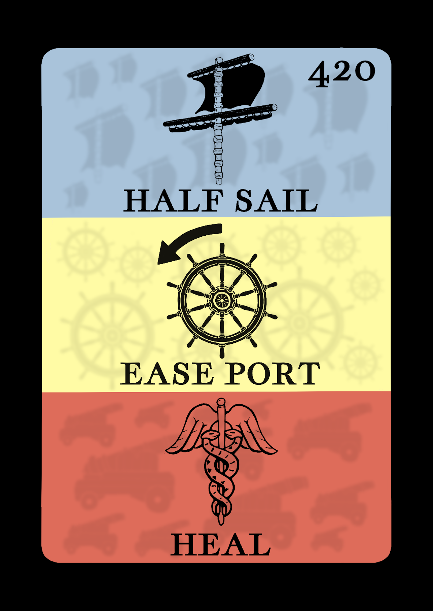
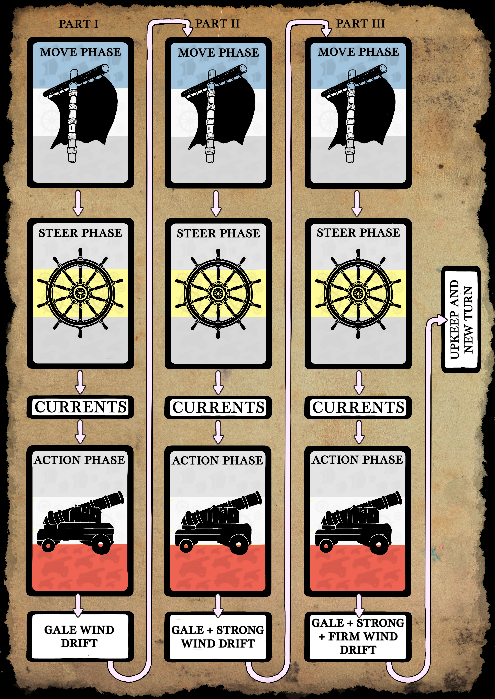
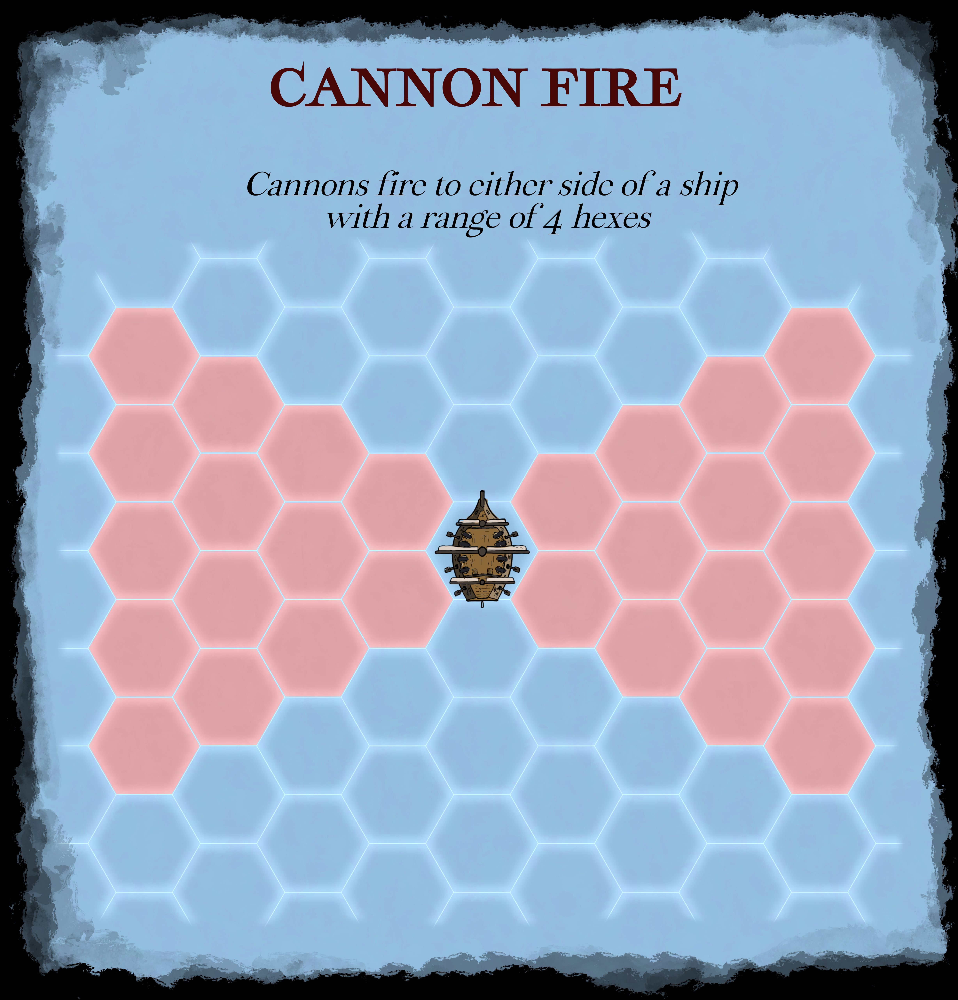

# Mammoth Sea Battles — Rules Specification

> Working spec, built up incrementally. This is the precise source of truth for
> the online version; player-facing instructions will be written from it later.
>
> Status: **Draft v0.17**

## 1. Overview
A pirate sea battle and race game between crews of **anthropomorphic mammoth and
dinosaur pirates**. Players fight each other, race to grab treasure, or both.

**Core mechanic: programmed movement**, in the RoboRally family (see
[`research/roborally.md`](research/roborally.md)). Players draw movement cards and
program their ship's orders face down. Then the orders are carried out and the ships
interact with each other and with the sea.

### 1.1 Kept from RoboRally
- Draw movement cards and program them face down, then reveal and resolve them.
- Ships **push** each other and **shoot** at each other.
- **The board moves ships**: sea currents work like RoboRally's conveyor belts.
- **Damage affects movement**.

### 1.2 Key differences from RoboRally
| # | Mammoth Sea Battles | RoboRally |
|---|---|---|
| D1 | **Hex** map | Square grid |
| D2 | **3 steps** per turn | 5 registers |
| D3 | Each step programs **sailing, steering and cannon separately** | One card per register |
| D4 | **Tides** change the board during play | Fixed board |
| D5 | **Wind** affects movement | None |
| D6 | Cannons mostly mounted **broadside** | Laser fires forward |
| D7 | Different damage model | Hand-size loss (classic) / damage cards in deck (2016) |
| D8 | **Crew** works a bit like upgrade/option cards | Option or upgrade cards |
| D9 | Two factions: mammoths vs dinosaurs | Generic robots |

## 1.3 Design pillars
- **P1. Simultaneous everything.** Everyone programs at the same time, and then **everyone executes
  each step at the same time**: all players move their own ships together. There is no going round the
  table, ship by ship. This is why the game scales to 8 players: adding players adds almost no waiting time.
- **P2. Trust at the table.** Physical play relies on players moving their own ships honestly and
  sorting out minor collisions in good faith. Rules should stay simple enough to make that easy.
- **P3. Embrace chaos.** Collisions, currents and plans going wrong are the fun. Don't over-engineer
  the rules to remove chaos; a relaxed, slightly anarchic vibe is the goal.
- **P4. The online version enforces what the table trusts.** The digital version needs a deterministic
  conflict rule for when ships interfere (see Q8) that gives the same result simultaneous play would at the table.

## 2. Players & duration
- Players: **2–4 for the first version; the target is up to 8**. Rules, components and the
  online engine should be designed so 8 is possible, even though playtesting starts at 4.
- Play time: _TBD_
- Age: _TBD_

## 3. Components

### 3.1 The board

- **Modular**: you build the sea by putting several hex **board tiles** together, so scenarios and
  board size can vary (this also helps it scale to 8 players, see Q3c).
- The play area is a **hex grid**. In the example the hexes are pointy-topped, with flat sides on the left and right *(to confirm, Q18)*.
- **Sea currents** are printed as arrows. A current acts on a ship sitting on it, **moving her and/or turning her** (like RoboRally conveyors and gears).

### 3.2 Board features seen in the example board
Interpretations marked ❓ are guesses, to be confirmed by the designer.

| Feature | What it looks like | Interpretation |
|---|---|---|
| Straight current | Single arrow along the hexes | Moves the ship 1 hex in the arrow's direction ❓ |
| Fast current | Double (and triple?) parallel arrows | Moves the ship 2 (3?) hexes, like RoboRally's express belts ❓ |
| Turning current | Curved arrow | Moves the ship and turns her ❓ |
| Eddy | Circular arrows inside one hex, clockwise or anticlockwise | Turns the ship in place (60° per activation?) ❓ |
| Dashed eddy | Same, with a dashed outline | Weaker, or only active at certain tides? ❓ |
| Gyre / loop current | Ring of arrows circling an island, or an oval loop over 2 hexes | Carries ships round the loop ❓ |
| Maelstrom | Large multi-ring spiral (lower right) | Pulls ships inward and turns them; damage or loss at the centre? ❓ |
| Numbered whirlpool ("1") | Two matching whirlpools | Linked pair: enter one, come out of the other ❓ |
| Sea caves A / B | Cave mouths on islands marked A and B, with exit arrows | Tunnels: enter A, exit at the other A, facing the arrow ❓ |
| Island | Land | Impassable; ships hitting it take collision damage? ❓ |
| Reef / rocks | Pink spiky edges round islands; wreck-strewn rocky hexes with a skull | Hazard: damage, grounding, or sinking? ❓ |
| Sandbanks | Yellow patterned areas | Shallows: impassable or slowing, **tide-dependent**? ❓ |
| Striped shallows | Pale green diagonal stripes | Shallow water or kelp, maybe exposed at low tide? ❓ |
| Rough water | Purple churning hex | Hazard, maybe damage or random drift? ❓ |
| Fog bank | White cloud (centre) | Blocks line of sight for cannon? ❓ |
| Storm | Dark cloud with lightning (left edge) | Damage or random wind; does it move? ❓ |
| Port town | Harbour town (bottom) | Repair, recruit crew, deliver treasure, start point? ❓ |
| Small wreck on sandbar | Upper left | Treasure location? ❓ |

### 3.3 Command cards
   

Each command card is split into **three coloured bands**, one for each kind of order:

| Band | Colour | Order type | Values seen so far |
|---|---|---|---|
| Top | Blue | **Sail** | No Sail, Half Sail, Full Sail |
| Middle | Yellow | **Steer** | Ease Port (small turn), Hard to Port (large turn) |
| Bottom | Red | **Action** (cannon background) | Fire Cannons, Heal, Repair |

Each card also has an **initiative number** in the top-right corner (e.g. 400, 420, 840, 860), used like
RoboRally's priority numbers (see §5.3). The hundreds digit seems to follow the sail band (4xx = Half Sail,
8xx = Full Sail), so faster cards win initiative. Some cards also have an **octopus icon 🐙** in the top-left corner. It is used to **move the sea monster**, an
**optional role/module** to be specified later (see §10).

Example cards seen:

| No. | Sail | Steer | Action | Icon |
|---|---|---|---|---|
| 400 | Half Sail | Ease Port | Fire Cannons | 🐙 |
| 420 | Half Sail | Ease Port | Heal | |
| 840 | Full Sail | Hard to Port | Heal | 🐙 |
| 860 | Full Sail | Hard to Port | Repair | |

### 3.4 Ship board

Each player has a **ship board** with **3 Parts (I, II, III)**, one per step of the turn. Each Part has three card slots, in this order:
**Move (Sail) → Steer → Action**. The slot art highlights the band that counts (blue top / yellow middle / red bottom), so
**a card placed in a slot uses only that slot's band**. The same card can be a Sail, Steer or Action order depending on where you put it.

The board also works as the turn-sequence reminder, printing Currents and Wind drift between the slots (see §5.2).

- **Up to 9 cards** per turn (3 Parts × 3 slots).
- **Empty slots**:
  - Empty **Move** slot → the **sail stays at its current level**. Sail level is a **persistent setting** carried from Part to Part and turn to turn.
  - Empty **Steer** slot → no turn.
  - Empty **Action** slot → no action.

### 3.5 Weather cards and weather circuit
      

- Weather cards are **hex-shaped**. Each shows a **wind strength** and a **wind direction** on a 6-point compass
  (**N, NE, SE, S, SW, NW**). These are the 6 directions of flat-topped hex sides, so the wind always runs along a hex direction.
- **Weather is predictable**: cards are drawn and placed on a **weather circuit** that shows the current weather and the **next two
  cards face up**. The circuit also **marks the tides** (§6.4).

**Weather board**

- A ring of **6 hex spaces** for weather cards, advancing **clockwise**.
- Each space is also a **tide state**: High → Mid → Mid → Low → Mid → Mid → (back to High).
  That is a **6-step tide cycle** with 3 levels (High / Mid / Low), so the sea is at Mid tide half the time.
  - Top space = **High**.
  - Two right-hand spaces = **Mid** (ebbing).
  - Bottom space = **Low**.
  - Two left-hand spaces = **Mid** (flooding).
- *How the current space is marked and how cards are refilled: Q37.*

| Card | Strength | Sail modifier (printed) | Wind drift per turn (§5.2) |
|---|---|---|---|
| Dead Calm | — | **No sail move** | 0 |
| Light (e.g. North) | Light | **−1 all sail moves** | 0 ❓ |
| Firm (e.g. North, SE) | Firm | none | 1 (Part III) |
| Strong (e.g. NE) | Strong | **+1 Full Sail moves** | 2 (Parts II, III) |
| Gale (e.g. NW) | Gale | **+1 all sail moves; 1 DD per Full Sail** | 3 (Parts I–III) |
| New Weather Front | — | **Reshuffle the weather deck and place new cards, including this one** | — |

Notes: the Gale card is spelled "GAIL" on the current artwork. **DD = Damage Die**, taken when damage occurs (§7.2).

## 4. Setup
_TBD_

## 5. Turn structure
A turn has **3 steps**. Programming happens once per turn and covers all 3 steps.

### 5.1 Programming
1. Draw command cards *(how many? Q7)*.
2. All players at the same time place cards face down into their ship board's 3 × 3 slots (up to 9).
3. Reveal *(all at once, or step by step? Q28)*.

### 5.2 Resolving each Part (I, II, III)
Each sub-step is carried out by **all ships simultaneously** (pillar P1):

1. **Move phase**: apply any Sail card (change sail level), then every ship sails according to her current sail level *(and wind? Q9)*.
   **Ships push** other ships they move into.
2. **Steer phase**: ships turn according to their Steer card.
3. **Currents**: ships on currents are moved and/or turned. **Currents do not push**.
4. **Action phase**: carry out Action cards (Fire Cannons, Repair, Heal, ...).
5. **Wind drift**: depends on wind strength and the Part:

| Part | Wind strengths that drift |
|---|---|
| I | Gale |
| II | Gale, Strong |
| III | Gale, Strong, Firm |

   So in one turn a **Gale drifts ships 3 times, Strong twice, Firm once** (any weaker wind: never?). This works like
   RoboRally's push panels, which only fire in certain registers.

### 5.3 Initiative
Cards carry **initiative numbers**, as in RoboRally. Ships still move **simultaneously** (P1); initiative is used to
**settle conflicts**, e.g. two ships trying to enter the same hex *(exact use: Q8, Q32)*.

### 5.4 Upkeep and new turn
After Part III: **Upkeep**, then a new turn begins *(full contents: Q31)*. Probably includes advancing the weather
circuit and the tide (Q37).

## 6. Movement & actions

### 6.1 Sailing: basic rule
Without the Points of Sail rule (§6.2), wind direction doesn't affect sailing:

| Sail level | Move phase |
|---|---|
| No Sail | 0 (the ship is still moved by currents and wind drift) |
| Half Sail | 1 hex forward |
| Full Sail | 2 hexes forward |

### 6.2 Points of Sail *(optional rule, intended as the standard)*

This is a real sailing effect, and it's what makes the game unique. How far a ship sails in the Move phase depends on her
**sail level** and her **heading relative to the wind**. With flat-topped hexes a ship faces one of 6 hex sides,
so there are 4 points of sail (mirrored port and starboard):

| Point of sail | Heading vs wind | No Sail | Half Sail | Full Sail |
|---|---|---|---|---|
| **Windward** (in irons) | Straight into the wind (0°) | 0 | **0** (can't sail into the wind) | **1 hex backwards** (taken aback) |
| **Close Hauled** | 60° off the wind | 0 | 1 forward | 2 forward |
| **Broad Reach** | 120° off the wind | 0 | 2 forward | **3 forward** (fastest) |
| **Running** | Straight downwind (180°) | 0 | 1 forward | 2 forward |

- The fastest sailing is with the wind to your side and behind you (broad reach).
- Sailing movement is ship movement, so ships **push** (§5.2 step 1).
- This is separate from **wind drift** (§5.2 step 5), which the weather may also apply on top.

### 6.3 Weather modifiers
The current weather card changes sailing moves (§3.5): Dead Calm = no sail move; Light −1 all; Strong +1 Full Sail;
Gale +1 all, plus DD for each Full Sail. These apply on top of the points of sail (Q39 for how they combine).

### 6.4 Tides *(inspired by Full Metal Planète, see [`research/full-metal-planete.md`](research/full-metal-planete.md))*
- **3 tide levels: High, Mid, Low**, cycling High, Mid, Mid, Low, Mid, Mid on the weather board (§3.5). Like Full Metal Planète's Low/Normal/High.
- Tides **change the board**: some terrain is sea at one tide and an obstacle at another.
- *Which terrain, how many tide levels, and what happens to a ship caught out: Q40.*

**Making it easy for players** (design goal). Ideas to playtest:
- Print the chart on every ship board, or on a **wind-rose card** that sits beside the board pointing downwind.
- A **ship token or base with sail numbers printed round its edge**: set it against the wind arrow and read off the move.
- The online version shows each ship's move distance (and a ghost preview) while programming.

## 7. Combat / conflict resolution

### 7.1 Cannon fire

- **Fire Cannons** (Action phase) fires **both broadsides** at once.
- **Range: 4 hexes.**
- **Arc** (from the diagram, with flat-topped hexes and the ship's bow pointing at a hex side): each broadside covers the
  **60° wedge abeam**, bounded by the forward-quarter and aft-quarter hex directions on that side, **including the
  hexes on those two boundary lines**. That's 2 + 3 + 4 + 5 = **14 hexes per side, 28 in total**.
  No fire forward or aft; the hexes directly ahead and astern are always safe.
- Engine note: in cube coordinates, a broadside arc is the set of hexes within distance 1–4 that lie in the sextant
  between the two neighbour directions on that side of the ship.
- *Targets, line of sight and damage: Q33.*

### 7.2 Damage dice (DD)
- Damage is dealt as **Damage Dice (DD)**: whenever damage occurs, the ship **takes DD**.
- Sources of DD so far: **Gale**: 1 DD per Full Sail (§3.5).
- *What a DD is, how it's rolled or read, and what it does: Q15, Q38.*

## 8. Winning & game end
_TBD_

## 10. Optional modules

### 10.1 Sea monster *(to be specified)*
- An optional role. Cards with the 🐙 icon relate to the sea monster's movement.
- To be covered later: who controls it (a player, or automatic), how 🐙 cards drive it, and what it does to ships.

## 9. Glossary
| Term | Definition |
|------|------------|
| DD | Damage Die: taken by a ship whenever damage occurs (§7.2). |

## Open questions
_Ambiguities and edge cases found while writing the spec, to resolve with the designer._

**Game modes and factions**
- Q1. Are battle and race separate modes/scenarios, or is it always both (treasure race with fighting allowed)?
- Q2. Are mammoths and dinosaurs mechanically different (asymmetric), or only cosmetically?
- ~~Q3. Player count?~~ → Answered: start with 4, target up to 8 (see §2).
- Q3a. Teams? Mammoths vs dinosaurs suggests teams are possible (e.g. 4v4 at 8 players).
- Q3b. What's the minimum? Does 2 players work, or 3?
- Q3c. Scaling to 8: how much does the board grow? (Downtime isn't a concern; see pillar P1.)

**Programming (D2, D3)**
- ~~Q4~~ → Answered: one shared deck of 3-band cards; a 3 × 3 ship board, one slot per order type per step (§3.4).
- ~~Q5~~ → Partly answered: movement → currents → wind drift (§5.2). Action timing is Q29.
- Q6. Sail is a persistent level (answered). What levels exist (e.g. Furled / Half / Full) and how many hexes does each move per Move phase? How does wind affect this? What is the starting sail level?
- Q6a. Steering happens **after** sailing, as a separate phase (answered). Is Ease 60° (one hex side) and Hard 120°? Are there starboard versions of every port card?
- Q6b. Pushing: how far is a ship pushed (1 hex, or as far as the pusher keeps moving)? Can a pushed ship push others in a chain? What happens when a ship is pushed into land, a reef or the board edge?
- Q7. Hand size: how many cards are drawn per turn? Is it a personal deck (2016 style) or dealt from a shared deck (classic)?
- Q8. Execution is simultaneous (P1). When two ships' moves conflict in the same step (both entering one hex, ramming head-on, swapping hexes), what happens at the table? For example: both stop, both take damage, the bigger or faster ship wins, or the players agree on the spot. The online version needs a written rule.

**Wind (D5)**
- ~~Q9~~ → Answered: points of sail chart (§6.2).
- ~~Q34~~ → Answered: Half = 1, Full = 2 (§6.1).
- Q35. ~~Is there a No Sail level? Is it on the cards?~~ Yes, No Sail is a Sail band (§3.3). ~~Is wind always a hex direction?~~ Yes (§3.5). What sail level do ships start at?
- Q36. Points of sail is checked using the heading at the **start** of the Move phase (steering comes after). Right?
- Q10. Wind strengths: Dead Calm / Light / Firm / Strong / Gale (from the weather cards). Do Light and Dead Calm cause no drift? How far does one drift move a ship (1 hex downwind?), and does drift push? Is wind global or does it vary by area? How do wind direction and strength change (die, card, track, at upkeep)?

**Tides & currents (D4)**
- Q11. What do tides change: shallows/sandbars/rocks appearing and disappearing, current direction, or both? Is it on a fixed cycle or random?
- Q12. Currents: distances and order of activation (like fast/slow conveyors)? Do they rotate ships?

**Combat & damage (D6, D7)**
- ~~Q13~~ → Answered: both broadsides, 60° wedge, range 4 (§7.1).
- Q14. Any limit on firing besides having the card (ammo, reload, crew needed)? Do other cards fire only one side, or other weapons fire forward ("mostly broadside")?
- Q33. Cannon resolution:
  - Does a broadside hit **every** ship in the arc, only the **nearest**, or a target the firer chooses?
  - Line of sight: do islands, reefs, fog or other ships block shots?
  - How much damage does a hit do? Does it vary with range? Is there a roll to hit?
  - Is all firing simultaneous within a Part?
- Q15. Damage model: hit locations (hull, mast/rigging, rudder, crew)? How does each one affect sailing and steering?
- Q16. What happens at zero hull (sunk, respawn, out of the game)? Is there ramming damage?

**Weather & tides (§3.5, §6.3, §6.4)**
- Q37. The weather board has 6 spaces, each marked with a tide state (answered). Still open:
  - Does it advance **one space per turn** at Upkeep (a 6-turn tide cycle)?
  - How is the current space marked (a marker token, or the card in a fixed "now" position)?
  - Are all 6 spaces filled, with the current card and the next 2 face up and the rest face down? Or only 3 cards, refilled from the deck as it advances?
  - Which tide do you start at?
- ~~Q38a~~ → Answered: DD = Damage Die, taken when damage occurs.
- Q38. Gale "1 DD per Full Sail": is that once for each **Move phase** sailed at Full Sail (up to 3 per turn), or once per turn? Strain on the rigging, so do sails or masts get damaged?
- Q38b. The damage die itself: what kind of die (d6? custom faces?), what results are on it, and is it **rolled** or **kept** (placed on the ship board as a damage marker)?
- Q39. Wind direction convention: is a "North Wind" one blowing **towards** the north (the way the card arrow points) or **from** the north (the sailors' convention)? We need to match the arrow, and sailors will read it the other way.
- Q39a. Combining modifiers with points of sail: does Light −1 make Full Sail windward −2 (2 hexes backwards), or is the minimum 0? Does Gale +1 let Half Sail move 1 hex into the wind? Does Dead Calm stop the Full Sail windward backwards move?
- Q39b. New Weather Front: are the visible circuit cards replaced as well, or only future ones?
- Q40. Tides: 3 levels (answered). Which terrain is tidal: the yellow sandbanks, the striped shallows, or both (with staggered thresholds like FMP's marsh and reef)? Does a ship caught on a tidal hex when it dries out get grounded (stuck until the tide returns), damaged, or both? Do tides change currents too?

**Board (§3)**
- Q18. Flat-topped hexes are confirmed by the cannon diagram and the N/NE/SE/S/SW/NW compass on the weather cards. Tiles: what shape and size is one board tile (e.g. 7-hex "flowers", or larger)? Are there rules for joining tiles, such as edges having to match?
- Q19. Confirm or correct every ❓ in §3.2.
- Q20. Currents act after ship movement in **every step** (§5.2). Still open: do all current types act at once, or in an order (e.g. fast currents first)?
- Q21. Is a current's turn absolute (the ship ends facing the arrow) or relative (turn 60° clockwise)?
- ~~Q22~~ → Answered: currents do not push (§5.2). Still open: does the ship just stay put, and what about a current carrying her into an island or reef?
- Q23. Which features are changed by **tides**? Are the sandbanks and shallows the tidal parts?
- Q24. Board edge: what happens to a ship that sails or drifts off the map?

**Command cards (§3.3–3.4)**
- ~~Q25~~ → Answered: only the slot's band counts (ship board art).
- ~~Q26a~~ → Answered: the numbers are initiative, as in RoboRally.
- ~~Q26~~ → Answered: 🐙 = sea monster movement (optional role, §10.1, deferred).
- Q32. Initiative details:
  - Which card's number counts in a given Part: the one in the Move slot, or the highest of the three? What if the Move slot is empty?
  - Does higher go first, as in classic RoboRally?
  - Is it used **only to settle conflicts** (keeping simultaneous play), or does it set a strict movement order at the table?
  - Does it also decide the order of Action-phase firing?
- ~~Q27~~ → Answered: sail stays the same, no steer, no action.
- Q28. Are all 9 cards revealed at once, or column by column as each step resolves?
- Q29. Actions happen after currents and before wind drift (answered). Does Fire Cannons fire both broadsides? Are all actions in a Part simultaneous (can two ships sink each other at once)? What's the difference between **Heal** (crew?) and **Repair** (ship?)?
- Q31. What happens in **Upkeep**: discard and draw, wind change, tide change, crew, treasure?
- Q30. Full list of band values in the deck (all sail, steer and action types) and the deck's makeup and size.

**Crew (D8)**
- Q17. How do you get crew, how many can you hold, and are they permanent or single-use? Can crew be lost to damage?

## Change log
- v0.1 — skeleton created.
- v0.17 — DD = damage die.
- v0.16 — weather board: 6-space circuit with High/Mid/Mid/Low/Mid/Mid tides.
- v0.15 — weather cards, weather circuit, weather sail modifiers, tides (Full Metal Planète style).
- v0.14 — No Sail confirmed as a card band.
- v0.13 — No Sail level (no sailing move; currents and drift still apply).
- v0.12 — basic sailing: Half 1, Full 2.
- v0.11 — points of sail chart (optional, intended as standard).
- v0.10 — 🐙 icon = sea monster movement (optional module, deferred).
- v0.9 — cannon fire: both broadsides, 60° arcs, range 4.
- v0.8 — card numbers are initiative.
- v0.7 — ship board layout (Parts I–III); order is Move → Steer → Currents → Action → Wind drift; wind strength sets drift count; empty slots defined; sail level persists.
- v0.6 — command cards (3 bands), 3 × 3 ship board, step order: movement → currents → wind. Currents don't push.
- v0.5 — design pillars: simultaneous execution, trust, embrace chaos. Removed my wrong claim that RoboRally scales poorly.
- v0.4 — board: modular hex tiles, currents, list of observed features from the example board.
- v0.3 — player count: 4 to start, target up to 8.
- v0.2 — overview, list of differences from RoboRally, first batch of open questions.
