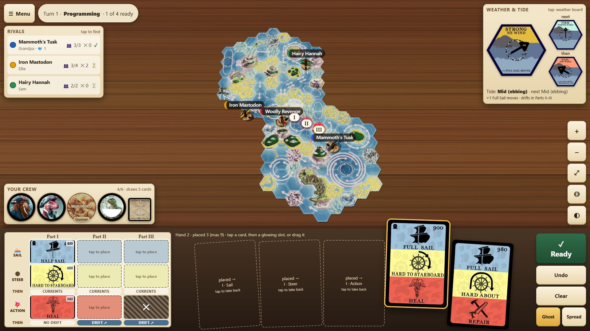
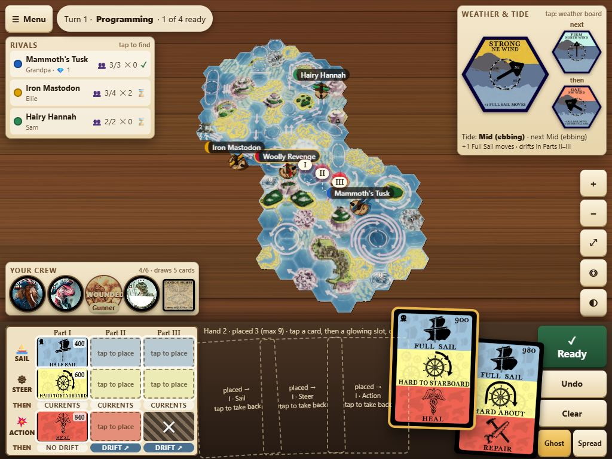
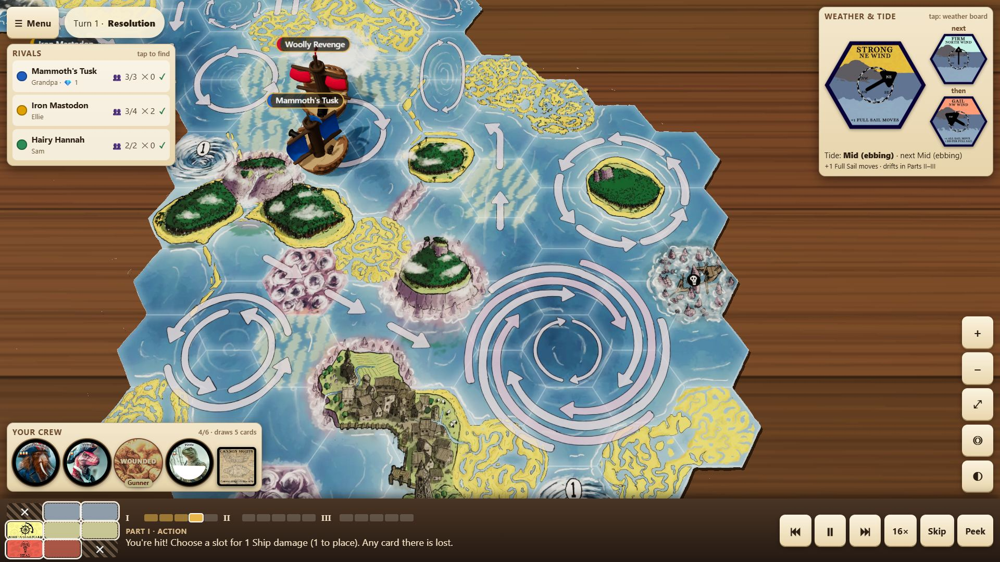
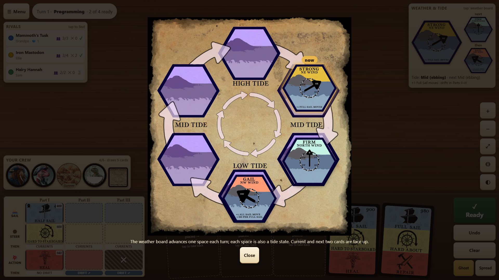
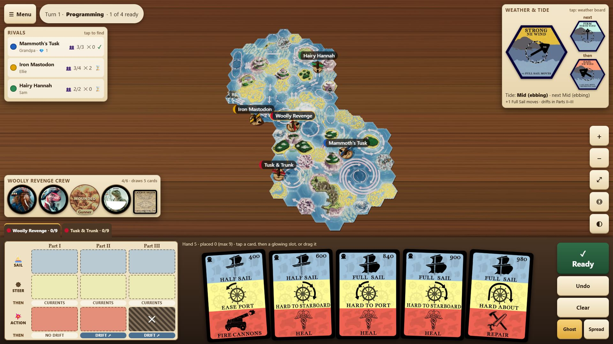
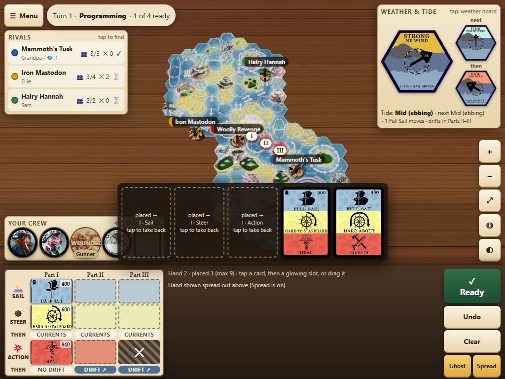

# Layout A mock-up (M0)

A clickable mock-up of **layout A, bottom dock** ([`web-spec.md` §4.2](../../web-spec.md)), built with the designer's real art.
It is step 3 of the wireframe process in [web-spec §4.4](../../web-spec.md): refine the chosen layout into a clickable mock-up and **test it
with real players**. It is not the M2 client. The code is in [`packages/client`](../../../packages/client).

**Approved by the designer on 2026-11-18**: the user interface is "looking fantastic"; loves the screenshots. Still to do: the family test below.

## Run it

```
npm install
npm run mockup          # http://localhost:5173 ; it also prints a Network address for an iPad on the same Wi-Fi
```

- `npm run mockup:build` writes a static site to `packages/client/dist/`. It uses relative paths, so it runs from any folder or web host.
- Add `?fleets` to the address to start with two ships (Fleets, rules §8.7). Add `?lod` to load the lighter ship model.
- `npm run mockup:assets` rebuilds the web images from the master art: `node packages/client/scripts/build-assets.mjs [artDir]`.
  The default art folder is `~/OneDrive/Documents/creative/Boardgames/Mammoth Sea Battles`, or set `MSB_ART_DIR`. The master art is
  only read, never changed.
- `npm run mockup:shoot` takes the screenshots below and runs the layout checks. Add `webkit` (Safari's engine) as the last argument
  to check in WebKit; those screenshots go to `screenshots/webkit/` and are not committed.
- Ship models: [`tools/ship-pipeline`](../../../tools/ship-pipeline/README.md) (Blender to GLB, about 9k triangles, and a 2.6k-triangle version for iPad).

## A turn in the mock-up

1. **Program.** Tap a card in the fanned hand; it lifts and the free slots glow. Tap a slot to place it, or drag the card there.
   Each slot shows **only the band that counts** (blue Sail, yellow Steer, red Action), cut from the real card art.
   A placed card leaves a gap in the hand ("placed → I · Sail"); tap the gap, or the slot, to take it back. **Undo** and **Clear** work as expected.
2. **Ghost preview.** As you place cards, translucent ghost ships show where you'll be after Parts I, II and III, with a dashed path.
   They use the real sailing rules from `msb-rules`: points of sail, the weather modifiers and wind drift. Red hexes mark your broadside arcs in any Part where you fire.
3. **Look around.** Drag to pan, scroll or pinch to zoom, and right-drag or two-finger drag to tilt. Tap a ship, or a rival in the list, to inspect her and see her arcs.
   Tap the weather panel for the weather board, and a crew card to see it full size. **Spread** lays the hand out flat with no overlap (for iPad).
4. **Ready.** The dock folds away and the turn plays out phase by phase: Move, Steer, Currents, Action, Drift for each Part. There are captions,
   play/pause/step, speed and Skip, and **Peek** brings the hand back. If you're hit, it **pauses for your decision**: tap a slot for each Ship damage,
   then a crew card for each Crew damage (rules §7.3–7.4). The dice are the real damage die from `msb-rules`.
5. **Upkeep.** A summary appears, the weather board moves on one space, everyone draws, and the next turn starts.

## Real art and placeholders

| Thing | In the mock-up |
|---|---|
| Command cards | **Real**: all 45 cards (`Cards/Movecards`). |
| Weather cards | **Real**: all 28, masked to their hex shape. The panel shows now, next and then. |
| Weather board | **Real**, with the three face-up cards on the ring (rules §3.5). |
| Sea maps | **Real**: three of the "Maps to print" (Two Isles, Whirlpools, Atoll; choose in the Menu). The hex grid is fitted to the art (flat-topped). |
| Ship model | **Real**: `pirateShipModel13-newedits.blend`, simplified. Sails and flag take the player colour; sails reef for Half Sail and furl for No Sail. |
| Ship board | Compact 3 × 3 board on the real ship board's parchment, with the Currents and Drift strips. Menu › Ship board shows the real board. |
| Crew | **Real** crew cards for Captain Mammoth and the Pirates. **Placeholders** for other crew: your portrait art, cropped round, with made-up roles (Gunner, Cook…). |
| Equipment | **Real** card art (the example ship has Cannon Sights). It can't be played yet. |
| Player guides | **Real**: Points of Sail and Cannon Fire, in Menu › Rules help. |
| Table | Placeholder: a plain wooden table. |

**Left out** (waiting for the rules or the tile data): currents, terrain, tides, pushing and collisions (ships can share a hex), treasure,
sinking, refits, the sea monster, and pass-and-play hand hiding. The rivals pick random programs that keep them on the board.

## Assumptions the mock-up had to make

These are guesses for testing only. They're not in `rules.md`; see the questions below.
- **Anchor** = sails down; no sail move and no wind drift in that Part.
- **Row Ahead 1 / Row Back 1** = move 1 hex ahead or astern whatever the wind; the sail level is unchanged.
- **Hard About** = turn 180°.
- Lightning Storm, Hurricane and New Weather Front play as Dead Calm.

## Checks

Playwright, Chromium (deviceScaleFactor 1), using the same checks as the [wireframes](../wireframe-evaluation.md). They were also run in WebKit, with the same results.

| Size | States checked | No scroll | UI outside viewport | Targets < 44 px | Min font |
|---|---|---|---|---|---|
| 1920×1080 | start, card selected, spread hand, weather board, menu, inspect, resolution, damage decision, upkeep, turn 2, Fleets | all | 0 | 0 | 11.5 px |
| 1024×768 | the same, except Fleets | all | 0 | 0 | 11 px |

Hand cards are 218 × 294 px on desktop and 151 × 204 px on iPad. Results: [`screenshots/checks.json`](screenshots/checks.json).

## Screenshots

| Programming (desktop) | Programming (iPad) |
|---|---|
|  |  |
| **Resolution, paused for damage** | **Weather board** |
|  |  |
| **Fleets: ship switcher** | **Spread hand (iPad)** |
|  |  |

## Questions for the designer (found in the art)

1. **Two cards are numbered 360**: *Row Back 1 / Hard About / Heal* and *Row Ahead 1 / Hard About / Repair*. Initiatives step by 20, so one may be meant to be 380.
2. **The cards have orders the rules don't cover yet**: **Anchor**, **Row Ahead 1** and **Row Back 1** in the blue band, and **Hard About** in the yellow band.
   There is **no "No Sail" card**, so is Anchor the way to drop sail? The numbering fits "faster wins": 1xx–3xx are Anchor and Row, 4xx–6xx Half Sail, 7xx–9xx Full Sail.
3. **Hex orientation (Q18):** the printed maps use **flat-topped** hexes (the mock-up's grid fits them exactly). Rules §3.1 still says the example board looks pointy-topped.
4. **Weather cards not in §3.5:** **Lightning Storm** ("2 DD at each turn start; draw another card each turn for wind") and **Hurricane**
   ("water level as high tide; 1 DD each turn; draw another card for wind").
5. Crew art: only Captain Mammoth and Pirate have finished round crew cards. There are 47 portraits; which roles are they meant to be?
6. 26 equipment cards exist (rules §7.10 has one example). The mock-up shows them but can't play them yet.

## What to watch for when the family plays

- Do they find the band rule (a card in a slot counts only for that slot's band) without being told?
- Do they use the ghost preview, and does it explain why the ship went where it did?
- iPad: is the fanned hand usable, or do they switch to Spread? Are the ships big enough at the default zoom?
- Can they tell whose ship is whose? Do they notice the next two weather cards?
