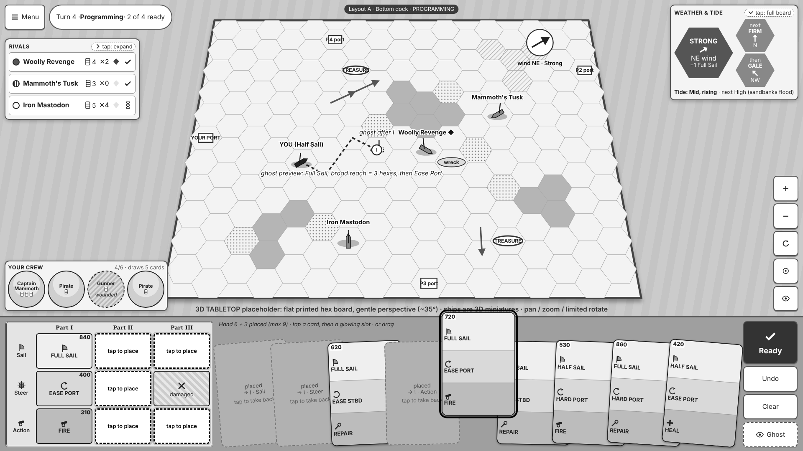
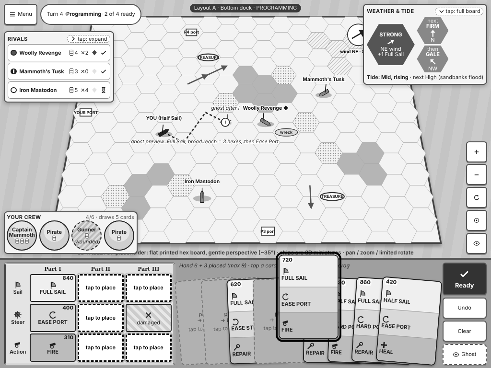
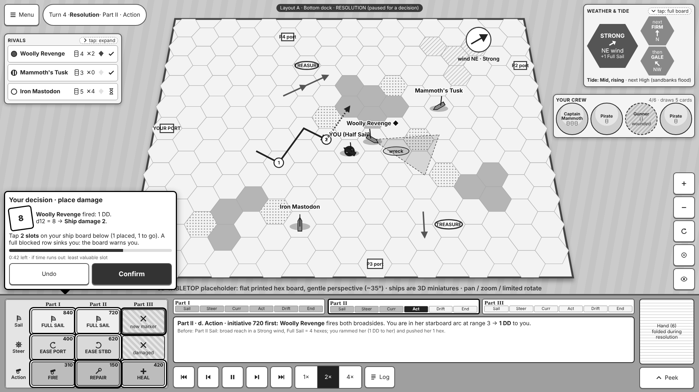
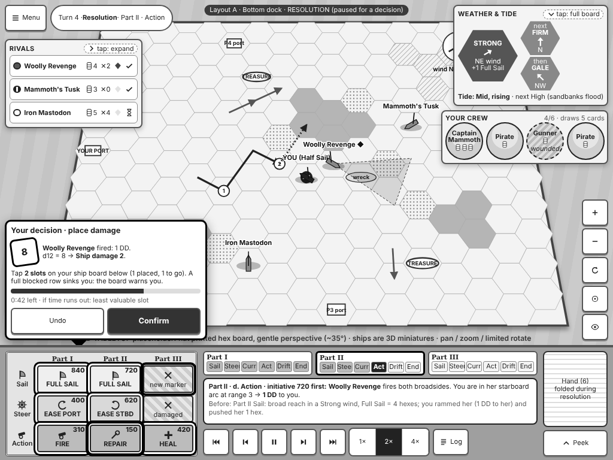
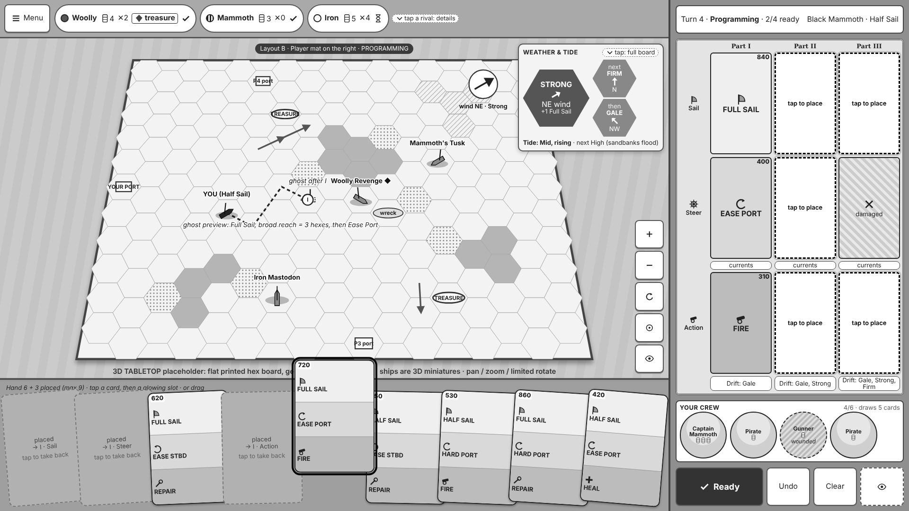
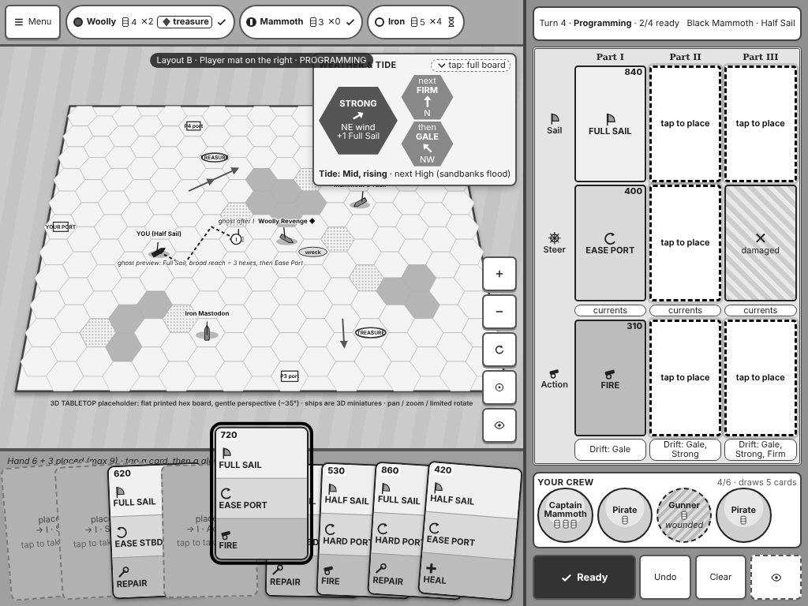
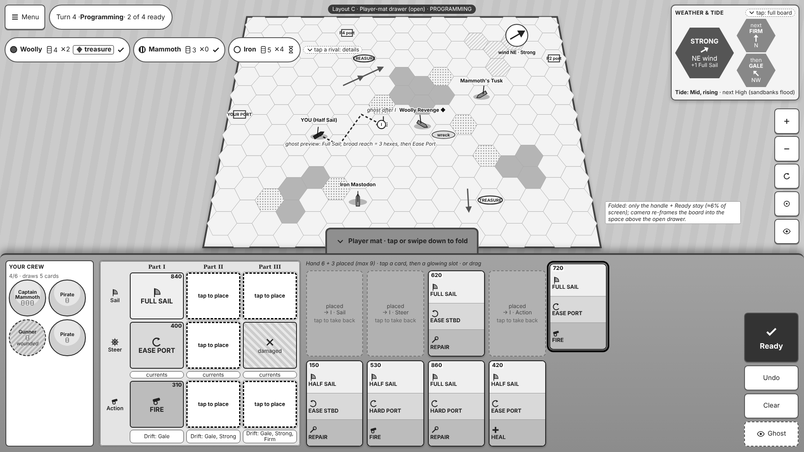
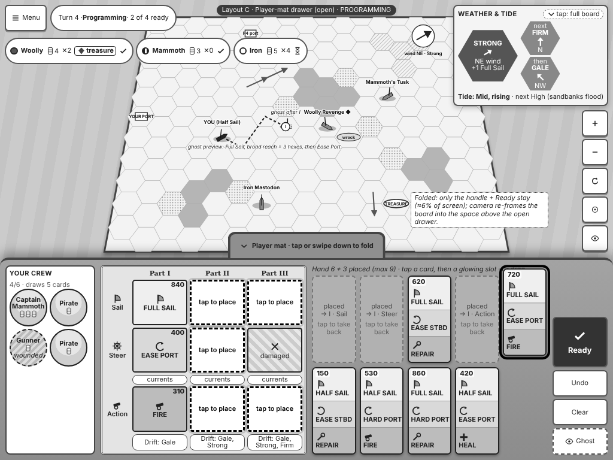
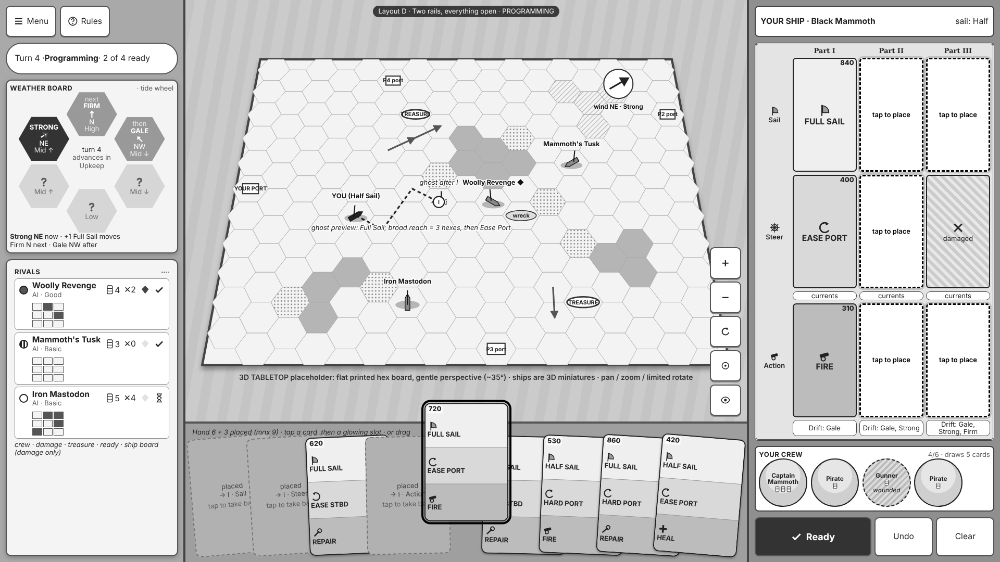
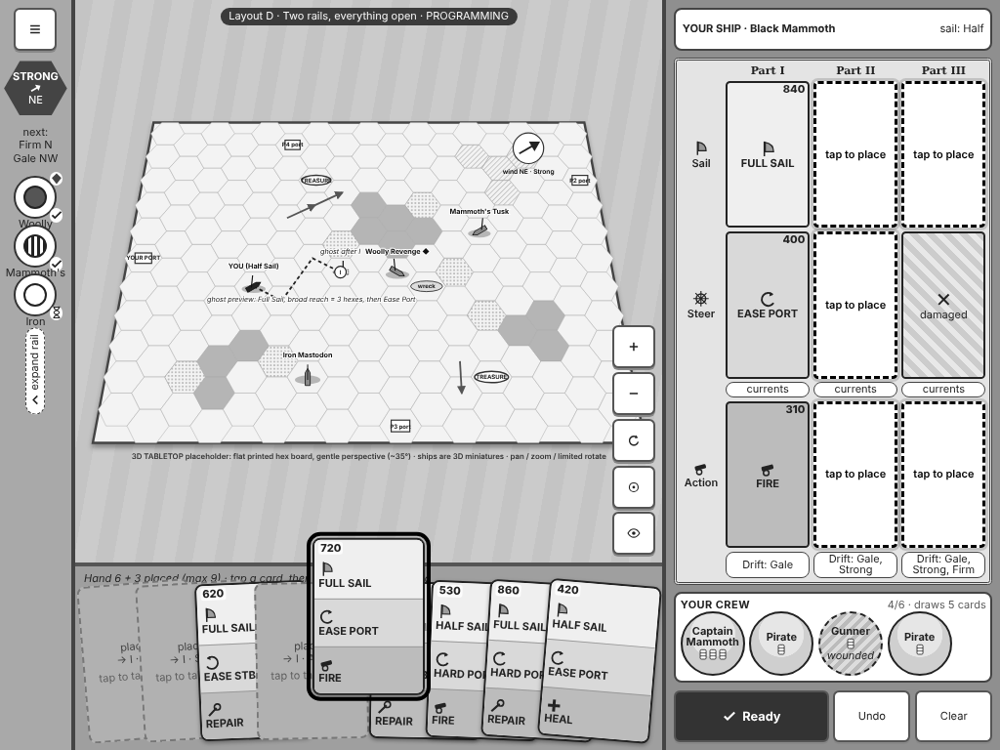

# Wireframe evaluation (M0)

> Milestone M0, step 2 of the wireframe process in [`web-spec.md` §4.4](../web-spec.md). There are four alternative layouts, each
> drawn in the **programming** state, plus a **resolution** variant of the recommended layout. They are judged against the five
> task walkthroughs and the criteria from §4.4, and against NFR-5/6/7.

## Files

| File | What it shows |
|---|---|
| [`wireframes/layout-a-bottom-dock.html`](wireframes/layout-a-bottom-dock.html) | **A. Bottom dock.** The table fills the top of the screen. A dock along the bottom holds the ship board, the hand fan and Ready. Weather, rivals and crew float over the table corners as small panels. |
| [`wireframes/layout-a-bottom-dock-resolution.html`](wireframes/layout-a-bottom-dock-resolution.html) | **A, resolution state.** The dock shrinks to a playback strip with the read-only ship board, a Part/phase track, a caption and playback controls. Here it is paused for a decision ("place damage"). |
| [`wireframes/layout-b-player-mat-right.html`](wireframes/layout-b-player-mat-right.html) | **B. Player mat on the right.** A faithful portrait ship board (Parts in columns, with Currents and Drift strips) plus crew, in a vertical mat on the right. The hand runs under the table and rivals are shown as chips above it. |
| [`wireframes/layout-c-drawer.html`](wireframes/layout-c-drawer.html) | **C. Player-mat drawer.** The table is full screen. A player mat slides up over it with crew, the full ship board, the hand laid out flat (2 rows, no overlap) and Ready. Folded, only the handle is left. |
| [`wireframes/layout-d-two-rails.html`](wireframes/layout-d-two-rails.html) | **D. Two rails, everything open.** The left rail is information (the weather board drawn as the physical tide wheel, plus detailed rivals with their damaged slots). The right rail is your mat. The hand sits under the table. On 4:3 screens the left rail collapses to an icon strip. |
| `wireframes/build.mjs` | Generates all the HTML files from shared parts (cards, ship board, tabletop). Run `node docs/ui/wireframes/build.mjs`. |
| `wireframes/shoot.mjs` | Takes the Playwright screenshots and runs the checks below. Run `node docs/ui/wireframes/shoot.mjs`. Results go to `wireframes/screenshots/checks.json`. |

Every HTML file is self-contained (inline CSS and SVG, no external assets) and responsive: the same file is used for both sizes.
Sizes are based on a unit `--u = min(1vh, 0.75vw)`, and every interactive element is at least `max(44px, 5.6u)`.

**Common conventions in all wireframes.**
- **Cards** show their three bands (Sail / Steer / Action) with an icon and the band name, as on the physical card. The **initiative** number sits in the top-left corner, so it still shows when cards overlap.
- **Placed cards** leave a dashed gap in the hand marked "placed → I · Sail". The hand keeps its order, and you tap the gap to take the card back.
- **The tapped card lifts**, and the slots it can go into get a thick dashed outline ("tap to place").
- **On the ship board, a placed card shows only the band that counts in that slot.** A damaged slot is hatched with a ✕.
- **The ghost preview** draws a dashed path on the table to where your ship ends after each programmed Part.

## Automated checks (Playwright, Chromium, deviceScaleFactor 1)

The checks are:
- **No scroll:** `documentElement` and `body` have `scrollWidth ≤ innerWidth` and `scrollHeight ≤ innerHeight`.
- **UI outside viewport:** every UI element's bounding box lies inside the viewport.
- **Touch targets:** every `.btn`, `.slot`, crew token, rival chip and drawer handle is at least 44 × 44 px.
- **Min font:** the smallest computed font size of any UI text.
- **Hand card:** for the fan layouts, the visible slice of the most-covered card; for C, the full card size.
- **Tabletop visible:** the share of 8-px sample points where `elementFromPoint` hits the tabletop and not a UI panel.

| Wireframe | Size | No scroll (scrollW×scrollH) | UI outside viewport | Targets < 44 px | Min font px | Hand card px (visible width × height) | Tabletop visible |
|---|---|---|---|---|---|---|---|
| A bottom dock | 1920×1080 | yes (1920×1080) | 0 | 0 | 11.9 | 131 × 262 | 58% |
| A bottom dock | 1024×768 | yes (1024×768) | 0 | 0 | 11 | **51** × 186 | 54% |
| A resolution | 1920×1080 | yes (1920×1080) | 0 | 0 | 11.3 | (hand folded) | 57% |
| A resolution | 1024×768 | yes (1024×768) | 0 | 0 | 11 | (hand folded) | 50% |
| B player mat right | 1920×1080 | yes (1920×1080) | 0 | 0 | 11.9 | 151 × 251 | 45% |
| B player mat right | 1024×768 | yes (1024×768) | 0 | 0 | 11 | 64 × 178 | **36%** |
| C drawer (open) | 1920×1080 | yes (1920×1080) | 0 | 0 | 11.9 | 137 × 206 (no overlap) | 46% |
| C drawer (open) | 1024×768 | yes (1024×768) | 0 | 0 | 11 | 74 × 146 (no overlap) | 44% |
| C drawer (folded)* | 1920×1080 / 1024×768 | yes | 0 | 0 | 11 | (hand hidden) | 91% / 87% |
| D two rails | 1920×1080 | yes (1920×1080) | 0 | 0 | 11.9 | 110 × 239 | 41% |
| D two rails | 1024×768 | yes (1024×768) | 0 | 0 | 11 | 57 × 170 | 43% |

\* The folded state of C was measured by hiding the drawer body with injected CSS. It has no separate file.

**All wireframes pass the no-scrollbar check at both sizes.** No element leaves the viewport, every touch target is at least 44 px
at iPad size, and no UI text is smaller than 11 px. The figures in the "Tabletop visible" column count the table around the printed
board too. The printed board itself is somewhat smaller.

## Screenshots

### A. Bottom dock (programming)

### A. Bottom dock (resolution, paused for "place damage")

### B. Player mat on the right

### C. Player-mat drawer (shown open)

### D. Two rails (left rail collapses on 4:3)

## Task walkthroughs

Taps are counted on iPad. A drag counts as one action, the same as a tap. Resolution was only drawn for A. For B, C and D it assumes
the same controls (track, caption, playback) placed where that layout has room. In B and D that is the mat or rail; in C the
drawer folds and a strip appears.

| Task | A. Bottom dock | B. Mat right | C. Drawer | D. Two rails |
|---|---|---|---|---|
| **1. Program a turn** (9 cards into 9 slots, then Ready) | 19 (9 × card + slot, + Ready); 10 by drag. The ghost path stays visible on the table the whole time. On iPad the overlapped cards (51 px slices) show the initiative and band icons but cut long names ("HARD PO…"), so expect about 1 extra lift per card considered. | 19 / 10. Big slots (about 95 × 150 px on iPad). Card slices are 64 px. | 19 / 10, plus about 2 to fold and reopen the mat to see the board, because the ghost path can be hidden under the drawer. Cards are fully visible and need no lifting. | 19 / 10. On desktop, same as B. On iPad the slices are 57 px. |
| **2. Understand why your ship ended where it did** | 0 taps: auto-replay with a caption for each step ("Broad reach in a Strong wind: Full Sail = 4 hexes"). 1 tap per step back, 1 tap for the log. The trail with numbered steps stays on the table (50–57% visible). | 0 / 1 per step. The table is only 36% on iPad, so the replay is smaller. | 0 / 1 per step. The drawer folds automatically, so the table gets the most room (87–91%). This is C's best task. | 0 / 1 per step. 41–43%. |
| **3. Place damage** (2 Ship damage) | 3 (2 slots + Confirm). The prompt points at the ship board, which stays on screen, so you still see the hit on the table. | 3. The largest targets, and the board is always open. | 3, but the drawer has to reopen over the table, so you lose sight of the hit while you decide. | 3. Large targets. |
| **4. Check upcoming weather** | 0: the badge shows the current card and the next two, plus the tide. 1 tap opens the full weather board. | 0 / 1 (same badge) | 0 / 1 (same badge) | Desktop: 0, and the full tide wheel is always open. iPad: 0 for the current card and the next two names, 1 tap for the wheel. |
| **5. See who's carrying treasure** | 0: ◆ in the rivals list, and ◆ on the ship's label on the table. | 0: a "◆ treasure" tag on the rival chip. | 0: chip tag. | 0: ◆ in the rivals panel (iPad: ◆ badge on the avatar). Desktop also shows each rival's damaged slots. |

Every task takes about the same number of taps in all four layouts: tap-to-place sets the count. The real differences are:
- how much of the table stays visible while you do the task;
- how readable the cards and slots are on iPad;
- whether anything has to be folded or unfolded mid-task.

## Scores

Scores run from 1 (poor) to 5 (best). Board visibility is scored on the iPad figure, the harder case:
≥ 55% → 5, 50–54% → 4, 45–49% → 3, 40–44% → 2, < 40% → 1. C gets 3, the average of its open (44%) and folded (87%) states.
The weights favour what §4.1 and NFR-6/7 stress: nothing hidden, iPad readability and the board (×2), and board-game feel (×1.5).

| Criterion (weight) | A. Bottom dock | B. Mat right | C. Drawer | D. Two rails |
|---|---|---|---|---|
| Clicks / taps per task (×1) | 4 | 4 | 3 (fold/unfold while programming) | 4 |
| Nothing needed is hidden (×2) | 4 (all visible; rival details 1 tap away) | 4 | 2 (ghost path and table half hidden while programming) | 4 (desktop 5; on iPad the rail collapses) |
| No scrolling (×1) | 5 | 5 | 5 | 5 |
| iPad readability (×2) | 3 (51 px card slices) | 4 (big slots, 64 px slices) | 5 (no overlap, 74 px cards) | 3 (57 px slices) |
| Board visibility (×2) | 4 (58% / 54%) | 1 (45% / 36%) | 3 (46% / 44% open, 91% / 87% folded) | 2 (41% / 43%) |
| Feels like a board game (×1.5) | 3 (HUD-like dock; the compact ship board drops the Currents and Drift strips) | 5 (a real player mat beside the table) | 4 (a mat pulled over the table) | 4 (the tide wheel and mat are faithful) |
| **Unweighted total (/30)** | **23** | **23** | **22** | **22** |
| **Weighted total (/47.5)** | **35.5** | **34.5** | **34** | **33** |

## Recommendation

**Use A, the bottom dock, as the base layout, and borrow one idea from each of B and C.**

- **Why A wins.**
  - It is the only layout that keeps more than half the screen for the table at both sizes, while showing everything you need for
    programming at once with nothing to unfold. The ghost preview, the main teaching tool while programming, is always in view.
  - The same dock turns into the playback strip during resolution, and the ship board stays on screen for damage prompts.
  - It scores highest on the weighted criteria. It is also the simplest layout to build and to make responsive.
- **Fix A's weak spot: the overlapped hand on iPad.** Add C's **"spread hand"** option. One tap lays the hand out flat in two rows,
  covering the table for a moment. Also allow a long-press on a card to enlarge it (but nothing should depend on hover).
- **Borrow B's faithful ship board:** add thin "currents" and "drift: Gale / Gale, Strong / Gale, Strong, Firm" labels to the compact
  board, so it reads as the physical board, which teaches the phase order.
- **Borrow C's fold:** during resolution, or on demand, the dock can fold away completely so the table gets about 90% of the screen.
  Decision prompts unfold it again.
- **Next step (§4.4 step 3):** build A as a clickable mock-up. Use real card art at iPad size to see whether 51 px slices are
  readable with the real typography and band colours. Then playtest it with family.

## Open questions for the designer

1. **Ship board shape.** The physical board is portrait (Parts in columns, with Currents and Drift between the rows). Layout A
   squashes it into a landscape strip and shows only the band that counts in each slot. Is that close enough to "looks like the box"?
2. **Damage on a slot that already holds a card this turn.** Does the marker cancel that card straight away, later in the same turn,
   or only from next turn? This changes the damage prompt and how the slot is drawn. The resolution wireframe shows a marker
   covering a card in Part III.
3. **Hand order.** Should the hand be sorted by initiative, grouped by band, or kept in draw order? Should placed cards leave a gap,
   as drawn, or close up?
4. **Public information about rivals.** Are rivals' damage markers (which slots are blocked) public? Layout D shows them, and they
   help planning. Their crew is face up, so it presumably is public.
5. **Weather board.** Our reading of the physical board: a 6-hex tide wheel (High, Mid, Mid, Low, Mid, Mid) with weather cards
   placed on it, and the current card plus the next two face up. Is that right? Does the tide move one step per turn?
6. **Ghost preview.** Show all three Parts at once (as drawn: a path with I / II / III markers), or only the Part being edited? Should
   it include currents and drift (teaching) or stop after steering (simpler)?
7. **Pass-and-play.** Where does the hand-over curtain sit ("Pass the device to Woolly Revenge's captain"), and does the dock hide
   while it shows? (Spec §7 W2.)
8. **Player colours.** Which sail or flag colours do the 8 physical ships use? They need to be colour-blind safe and also coded by
   pattern or icon (NFR-12). The wireframe uses greyscale patterns.
9. **Tap-to-place flow.** After you place a card, should the selection jump to the next empty slot automatically (fewer taps)? Or
   should it wait for the next card tap (more deliberate, closer to the table)?
10. **Damage preferences.** Offer the "block Action slots first" style of preset (online-version.md) in the dock, so most damage
    needs no prompt?

## Review notes (parent session)
- The board placeholder draws **pointy-topped** hexes; the game uses **flat-topped** hexes (rules §3.1). Fix in the mock-up stage.
- Open question "does a damage marker cancel a card already in that slot?" is already answered in rules §7.3: yes, the card is removed.
- Rivals' damage markers are public at the table (they sit on visible ship boards); only programmed cards and hands are hidden.

## Decision
**Layout A chosen** by the designer, with the hand displayed as a fanned hand of cards.
